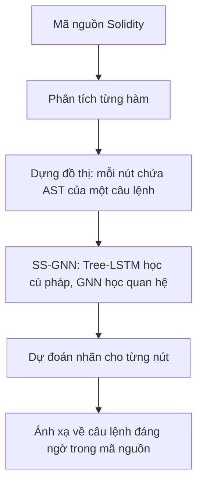

# Tổng quan đề tài phát hiện lỗ hổng hợp đồng thông minh

## 1. Thông tin tài liệu tham khảo

- **Tên bài báo:** *Fine-grained smart contract vulnerability detection by heterogeneous code feature learning and automated dataset construction*.
- **Tên tiếng Việt đề xuất:** Phát hiện lỗ hổng hợp đồng thông minh ở mức câu lệnh bằng học đặc trưng mã nguồn không đồng nhất và xây dựng bộ dữ liệu tự động.
- **Tác giả:** Jie Cai, Bin Li, Tao Zhang, Jiale Zhang, Xiaobing Sun.
- **Nơi công bố:** *Journal of Systems and Software*, tập 209, tháng 3/2024, mã bài 111919.
- **DOI:** [10.1016/j.jss.2023.111919](https://doi.org/10.1016/j.jss.2023.111919).
- **Tài liệu trong thư mục `docs`:** [Bản PDF tham khảo](<Fine-grained smart contract vulnerability detection by heterogeneous code feature learning and automated dataset construction - Science.pdf>).

**Phạm vi tổng hợp:** PDF hiện có là bản in 8 trang của trang ScienceDirect, gồm tóm tắt, giới thiệu và trích đoạn các mục; chưa phải toàn văn bài báo. Các nội dung về kết quả nghiên cứu dưới đây được giới hạn trong phần đã đọc. Hướng triển khai ở mục 8 là đề xuất cho đồ án của nhóm, không phải cấu hình thực nghiệm đã được xác nhận của tác giả.

## 2. Đề tài nghiên cứu vấn đề gì?

Hợp đồng thông minh (smart contract) là chương trình chạy trên blockchain, có thể quản lý tài sản và thực hiện giao dịch theo các điều kiện được lập trình. Lỗ hổng trong mã có thể gây thất thoát tài sản hoặc khiến chức năng hoạt động sai.

Đề tài hướng đến xây dựng hệ thống sử dụng học sâu để phân tích mã nguồn Solidity và chỉ ra những câu lệnh có khả năng chứa lỗ hổng. Thay vì chỉ kết luận cả hợp đồng có vấn đề, hệ thống hướng đến xác định vị trí cụ thể để người phát triển kiểm tra.

| Thành phần | Nội dung |
| --- | --- |
| Đối tượng nghiên cứu | Mã nguồn hợp đồng thông minh viết bằng Solidity. |
| Đầu vào | Mã nguồn hợp đồng và, trong giai đoạn huấn luyện, nhãn của các câu lệnh. |
| Đầu ra khi phát hiện | Dự đoán cho từng câu lệnh và vị trí câu lệnh đáng ngờ trong mã nguồn. |
| Phương pháp chính | Biểu diễn mã bằng cây và đồ thị, kết hợp Tree-LSTM với GNN. |
| Hướng xây dựng dữ liệu | Tận dụng các biện pháp lập trình an toàn để tạo mẫu và gán nhãn tự động. |

## 3. Giải thích tên đề tài và các thuật ngữ

| Thuật ngữ | Giải thích |
| --- | --- |
| **Smart contract vulnerability detection** | Phân tích hợp đồng thông minh để phát hiện lỗ hổng bảo mật. |
| **Fine-grained** | Phát hiện ở mức chi tiết, cụ thể là mức câu lệnh trong bài báo. Một câu lệnh có thể trải trên nhiều dòng mã. |
| **Heterogeneous code feature learning** | Học các đặc trưng mã nguồn có cấu trúc khác nhau: cú pháp dạng cây và quan hệ giữa các câu lệnh dạng đồ thị. |
| **Automated dataset construction** | Tự động tạo mẫu dữ liệu và nhãn để giảm công sức gán nhãn thủ công. |
| **SBP — Security Best Practices** | Các biện pháp lập trình an toàn được áp dụng để bảo vệ mã khỏi lỗ hổng. |
| **AST — Abstract Syntax Tree** | Cây cú pháp trừu tượng, thể hiện cấu trúc của biến, biểu thức, phép toán và lời gọi hàm. |
| **CFG — Control Flow Graph** | Đồ thị luồng điều khiển, thể hiện các đường thực thi có thể xảy ra giữa các câu lệnh. |
| **Tree-LSTM** | Mô hình học biểu diễn dữ liệu dạng cây; bài báo sử dụng thành phần child-sum Tree-LSTM. |
| **GNN — Graph Neural Network** | Mạng nơ-ron đồ thị, học biểu diễn bằng cách truyền và tổng hợp thông tin giữa các nút. |
| **SS-GNN — Syntax Sensitive Graph Neural Network** | Mô hình được đề xuất trong bài báo, kết hợp học cấu trúc cú pháp và quan hệ giữa các câu lệnh. |

## 4. Hai thách thức chính

### 4.1. Thiếu dữ liệu có nhãn đến từng câu lệnh

Muốn mô hình chỉ ra câu lệnh có lỗ hổng, cần có dữ liệu huấn luyện xác định được vị trí đó. Việc gán nhãn thủ công đòi hỏi nhiều thời gian và kiến thức chuyên môn.

Bài báo thảo luận hạn chế của các hướng tạo dữ liệu như kiểm tra thủ công, tận dụng kết quả công cụ phát hiện và chèn lỗ hổng theo mẫu. Thách thức là cân bằng chi phí xây dựng dữ liệu với độ chính xác và mức chi tiết của nhãn.

### 4.2. Khó học đầy đủ cả cú pháp và ngữ cảnh

Thông tin bên trong một câu lệnh có cấu trúc dạng cây, trong khi quan hệ giữa các câu lệnh thường được biểu diễn bằng đồ thị. Theo lập luận của tác giả, việc chuyển toàn bộ thành đồ thị rồi học theo một cơ chế chung có thể làm mất đặc điểm phân cấp của cây cú pháp.

Vì vậy, mô hình cần khai thác cả cấu trúc bên trong câu lệnh và ngữ cảnh của câu lệnh trong hàm.

## 5. Phương pháp xây dựng dữ liệu tự động

Tác giả dựa trên nhận xét: khi người phát triển áp dụng một biện pháp bảo vệ cho đoạn mã, điều đó có thể phản ánh hiểu biết của họ về rủi ro tại vị trí đó. Nếu loại bỏ cơ chế bảo vệ, đoạn mã có thể trở về dạng chứa lỗ hổng.

Quy trình được mô tả trong tài liệu:

1. Tìm các câu lệnh được bảo vệ bằng SBP trong mã Solidity.
2. Loại bỏ cơ chế bảo vệ để tạo biến thể mã có khả năng chứa lỗ hổng.
3. Gán nhãn các câu lệnh liên quan làm mẫu có lỗ hổng.
4. Gán nhãn *neutral* cho các đoạn mã không áp dụng SBP theo quy trình của bài báo.

Lợi ích kỳ vọng là giảm công sức gán nhãn và tận dụng ngữ cảnh mã có sẵn, thay vì chỉ tạo các ví dụ lỗi rời rạc.

**Điểm cần kiểm chứng khi triển khai:** loại bỏ một cơ chế bảo vệ chưa đủ để chứng minh mã có thể bị khai thác; kết quả còn phụ thuộc ngữ cảnh và các cơ chế bảo vệ khác. Nhãn *neutral* cũng không đồng nghĩa với việc đã chứng minh mã hoàn toàn an toàn. Đây là vấn đề nhóm cần xem xét khi đánh giá chất lượng dữ liệu.

## 6. Phương pháp phát hiện bằng SS-GNN

### 6.1. Biểu diễn mã nguồn

Phương pháp xây dựng đồ thị cho từng hàm trong hợp đồng. Mỗi nút chứa cây AST con tương ứng với một câu lệnh, còn các cạnh biểu diễn quan hệ giữa các câu lệnh, chẳng hạn quan hệ luồng điều khiển.

Cách biểu diễn này giữ lại hai mức thông tin:

- **Bên trong câu lệnh:** cấu trúc biểu thức, phép toán, biến và lời gọi hàm.
- **Giữa các câu lệnh:** ngữ cảnh và quan hệ thực thi trong hàm.

### 6.2. Học đặc trưng và dự đoán

Thành phần child-sum Tree-LSTM học cấu trúc cây AST của câu lệnh. Thành phần GNN truyền thông tin giữa các nút để học quan hệ và ngữ cảnh. Mô hình kết hợp được gọi là SS-GNN.

Sau khi học biểu diễn, mô hình dự đoán nhãn cho từng nút. Do mỗi nút tương ứng với một câu lệnh, bài toán phát hiện lỗ hổng được chuyển thành **bài toán phân loại nút trên đồ thị**.

Sơ đồ sau diễn giải luồng phát hiện ở mức tổng quan, không phải hình gốc trong bài báo:

## 7. Kết quả được nêu trong tài liệu

### 7.1. Quy mô bộ dữ liệu

Theo phần giới thiệu ở trang 4 của PDF, tác giả xây dựng bộ dữ liệu gồm:

| Loại dữ liệu | Số lượng được báo cáo |
| --- | ---: |
| Dòng câu lệnh có lỗ hổng | 21.183 |
| Dòng câu lệnh trung tính | 103.585 |

Đây là số dòng câu lệnh được tác giả báo cáo, không phải số hợp đồng.

### 7.2. Hiệu quả phát hiện

Theo trích đoạn ở trang 5, trong thí nghiệm phát hiện **reentrancy ở cấp hợp đồng**, phương pháp đạt:

| Chỉ số | Kết quả | Ý nghĩa |
| --- | ---: | --- |
| Precision | 91,40% | Trong các trường hợp mô hình cảnh báo, tỷ lệ được xác định đúng theo nhãn đánh giá. |
| Recall | 89,77% | Trong các trường hợp có lỗ hổng theo nhãn đánh giá, tỷ lệ mô hình phát hiện được. |

Tác giả báo cáo so sánh với ba phương pháp học sâu và hai phương pháp phân tích tĩnh, đồng thời so sánh SS-GNN với bốn mô hình GNN phổ biến.

**Giới hạn diễn giải:** các chỉ số trên thuộc đánh giá cấp hợp đồng, không phải kết quả định vị câu lệnh. Tài liệu hiện có không cung cấp đầy đủ bảng kết quả, giá trị F1, cách chia dữ liệu và cấu hình huấn luyện. Vì vậy, chưa đủ thông tin để khẳng định nhóm có thể tái lập chính xác kết quả bài báo.

## 8. Hướng triển khai đề xuất cho đồ án nhóm

### 8.1. Phạm vi ban đầu

Nhóm có thể bắt đầu với một loại lỗ hổng, chẳng hạn **reentrancy**, và xây dựng quy trình hoàn chỉnh ở quy mô nhỏ trước khi mở rộng. Reentrancy liên quan đến việc luồng thực thi bị gọi trở lại khi thao tác trước đó chưa hoàn tất theo cách an toàn.

Mục tiêu triển khai đề xuất: xây dựng công cụ nhận mã nguồn Solidity, phân tích cấu trúc mã và đánh dấu các câu lệnh đáng ngờ để hỗ trợ người phát triển kiểm tra.

### 8.2. Các giai đoạn thực hiện

| Giai đoạn | Công việc chính | Sản phẩm |
| --- | --- | --- |
| 1. Nghiên cứu và xác định phạm vi | Tìm hiểu lỗ hổng mục tiêu, SBP liên quan và tiêu chí gán nhãn. | Mô tả bài toán và quy tắc dữ liệu. |
| 2. Chuẩn bị dữ liệu | Thu thập mã Solidity, tạo hoặc tận dụng nhãn và kiểm tra thủ công một phần mẫu. | Bộ dữ liệu có vị trí câu lệnh và nguồn gốc mẫu. |
| 3. Biểu diễn mã | Trích xuất AST, dựng đồ thị và lưu ánh xạ từ nút về vị trí mã nguồn. | Chương trình tiền xử lý dữ liệu. |
| 4. Xây dựng mô hình | Huấn luyện mô hình cơ sở, sau đó bổ sung thành phần học cây để so sánh. | Mô hình phát hiện và kết quả thực nghiệm. |
| 5. Đánh giá và demo | Đo chỉ số, phân tích lỗi và hiển thị câu lệnh đáng ngờ trong tệp `.sol`. | Bản demo và báo cáo đánh giá. |

### 8.3. Cách đánh giá đề xuất

- Sử dụng Precision, Recall và F1 ở mức câu lệnh để phù hợp mục tiêu phát hiện chi tiết.
- Nếu đánh giá thêm ở cấp hợp đồng, trình bày riêng kết quả của hai mức.
- So sánh mô hình cơ sở với mô hình có thêm Tree-LSTM để kiểm tra lợi ích của việc học cấu trúc cú pháp.
- Phân tích các trường hợp cảnh báo nhầm và bỏ sót, thay vì chỉ báo cáo một chỉ số tổng hợp.
- Kiểm tra chất lượng nhãn trên một phần dữ liệu tạo tự động.
- Giữ hợp đồng gốc và các biến thể gần giống nhau trong cùng một tập khi chia dữ liệu huấn luyện, xác thực và kiểm thử, nhằm hạn chế rò rỉ dữ liệu.

### 8.4. Sản phẩm dự kiến

1. Bộ dữ liệu hợp đồng thông minh có nhãn ở mức câu lệnh.
2. Chương trình xử lý mã nguồn và dựng biểu diễn cây, đồ thị.
3. Mô hình phát hiện cùng hướng dẫn huấn luyện và chạy dự đoán.
4. Bản demo nhận tệp Solidity và đánh dấu câu lệnh đáng ngờ.
5. Báo cáo thực nghiệm, so sánh mô hình và phân tích hạn chế.

## 9. Thông tin cần bổ sung từ toàn văn bài báo

Trước khi tái hiện đầy đủ phương pháp của tác giả, nhóm cần xác minh:

- Danh sách loại lỗ hổng và các SBP tương ứng được sử dụng.
- Quy tắc nhận diện, loại bỏ SBP và gán nhãn câu lệnh.
- Nguồn dữ liệu, cách lọc trùng và cách chia các tập dữ liệu.
- Định nghĩa nút, cạnh và cách xử lý các cấu trúc Solidity trong đồ thị.
- Kiến trúc chi tiết của SS-GNN, hàm mất mát và tham số huấn luyện.
- Các mô hình đối chứng, bảng kết quả đầy đủ và quy trình đánh giá.
- Mã nguồn hoặc bộ dữ liệu do tác giả công bố, nếu có.

## 10. Đoạn mô tả đề tài dùng trong đề cương

Đề tài nghiên cứu phương pháp phát hiện lỗ hổng bảo mật trong hợp đồng thông minh Solidity ở mức câu lệnh bằng học sâu. Hướng tiếp cận kết hợp đặc trưng cú pháp từ cây cú pháp trừu tượng với quan hệ giữa các câu lệnh trong đồ thị mã nguồn, sử dụng thành phần Tree-LSTM và mạng nơ-ron đồ thị. Đồng thời, đề tài khảo sát cách xây dựng dữ liệu tự động dựa trên các biện pháp lập trình an toàn nhằm giảm công sức gán nhãn. Kết quả hướng đến là một hệ thống hỗ trợ xác định vị trí câu lệnh có khả năng chứa lỗ hổng, đi kèm đánh giá thực nghiệm về hiệu quả phát hiện và chất lượng dữ liệu.
