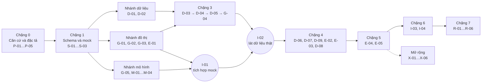

# Kế hoạch triển khai đồ án — nhóm 3 thành viên

**Đề tài:** *Fine-grained smart contract vulnerability detection by heterogeneous code feature learning and automated dataset construction* (Cai và cộng sự, *Journal of Systems and Software*, tập 209, bài 111919, DOI [10.1016/j.jss.2023.111919](https://doi.org/10.1016/j.jss.2023.111919)).

**Cách đọc kế hoạch**

- Kế hoạch chỉ nêu thứ tự thực hiện, quan hệ phụ thuộc và điều kiện chuyển bước. Không có lịch, mốc thời gian hay ước lượng thời lượng.
- Nhãn nguồn: **[TL]** là thông tin theo tài liệu, kèm trang PDF; **[ĐX]** là đề xuất của nhóm; **[CXM]** là điểm cần xác minh khi có toàn văn, mã nguồn hoặc dữ liệu của tác giả.
- Các việc trong mục C.0 đến C.7 đều thuộc phần **CỐT LÕI**. Mục C.8 là phần **MỞ RỘNG**, chỉ làm khi đủ điều kiện ghi ở đó.
- "Trang" luôn là số trang của tệp PDF trong `docs/` (bản in 8 trang).

---

## A. Hiện trạng, căn cứ và phạm vi

### A.1. Hiện trạng repository

- Kho Git ở nhánh `main`, chưa có commit nào. Chỉ có `docs/` (4 tệp tài liệu) và `prompt/` (1 tệp yêu cầu).
- Chưa có mã nguồn, dữ liệu, mô hình, cấu hình môi trường hay kết quả thí nghiệm. Mọi thành phần kỹ thuật trong kế hoạch đều phải xây mới.

### A.2. Tài liệu đã đọc

| Tài liệu | Cách đã đọc | Vai trò trong kế hoạch |
| --- | --- | --- |
| `docs/Project.md` | Đọc toàn bộ | Căn cứ duy nhất cho yêu cầu đồ án và thang điểm 1-3-5-1. |
| PDF bài báo | Kết xuất và xem trực tiếp cả 8 trang dưới dạng ảnh | Căn cứ chính cho mô tả phương pháp. Đây là bản in trang tóm tắt trên ScienceDirect (đường dẫn `/abs/`), không phải toàn văn. |
| Bản `.md` của bài báo | Đọc toàn bộ, đối chiếu với PDF | Chỉ dùng để tra cứu chữ. Tiêu đề bị vỡ ("automated dataset ☆ con ab stru ction"), các đoạn Method, Results, Conclusion và Introduction bị dồn vào một ô bảng. Khi lệch, dùng PDF. |
| `docs/tong-quan-de-tai-smart-contract-vulnerability-detection.md` | Đọc toàn bộ | Mục 1–7 tóm tắt bài báo và khớp với PDF. Mục 8 là hướng triển khai do người viết đề xuất [ĐX], không phải cấu hình của tác giả. Mục 9 là danh sách cần xác minh, dùng làm đầu vào cho P-01. |

### A.3. Thông tin đã xác nhận từ PDF

| Nội dung | Trang | Thành phần kế hoạch dùng thông tin này |
| --- | --- | --- |
| Đồ thị mã "merges AST subtrees into CFG nodes": nút là cây AST con của một câu lệnh, quan hệ nền giữa các nút là CFG | 1 (Highlights), 3 | P-03, G-02, G-03 |
| Đồ thị được dựng cho từng hàm; mô hình dự đoán từng nút; phương pháp có pha huấn luyện và pha phát hiện | 5 (mục *Vulnerability detection approach*) | P-03, M-04, I-03 |
| Phát hiện mức câu lệnh được mô hình hóa thành bài toán phân loại nút | 4 | P-04, M-02 |
| SS-GNN bổ sung *child-sum tree-LSTM cell* (Tai và cộng sự, 2015) để học cú pháp từ cây trước khi truyền thông điệp giữa các nút kề | 2 (Method), 3 | P-04, M-01, M-02 |
| Xây dữ liệu: định vị và loại bỏ SBP để khôi phục dạng mã chưa được bảo vệ, gán nhãn vulnerable; đoạn mã không áp dụng SBP gán nhãn neutral | 2, 3 | P-02, D-03, D-04, D-05 |
| Quy mô dữ liệu: 21.183 "lines of vulnerable statements" và 103.585 "lines of neutral statements" | 4 | D-08 (chỉ so sánh mô tả). Đơn vị "dòng câu lệnh" chưa rõ cách đếm câu lệnh nhiều dòng [CXM]. |
| Đối chứng: 3 phương pháp học sâu chỉ hỗ trợ cấp hợp đồng (Zhuang 2020, Wu 2021, Zhang 2022a) và 2 phương pháp phân tích tĩnh hỗ trợ mức chi tiết (Tikhomirov 2018, Feist 2019) | 2 (Results), 4 | P-04, E-03. Việc hiểu hai trích dẫn sau là SmartCheck và Slither là suy luận từ tên tác giả và năm [CXM]. |
| So sánh SS-GNN với 4 mô hình GNN phổ biến (Li 2015, Kipf & Welling 2016, Veličković 2017, Brody 2021). Tiêu đề bài Brody, "How attentive are graph attention networks?", hiện ở trang 6 | 4, 6 | P-04, X-01. Tên GGNN, GCN, GAT, GATv2 là suy luận từ trích dẫn [CXM]. |
| Table 4: reentrancy **cấp hợp đồng**, Recall 89,77%, Precision 91,40%; giá trị F1 bị cắt | 5 | Chỉ dùng làm bối cảnh trong R-03. Không dùng làm kết quả dự kiến hay ngưỡng của nhóm. |
| Bài báo nói đã đánh giá ở cả mức câu lệnh và mức hợp đồng, nhưng bản in không có số liệu mức câu lệnh | 4 | P-04: nhóm tự định nghĩa chỉ số mức câu lệnh. |
| Danh mục tham khảo có ConsenSys "Solc-typed-ast" (2022), ConsenSys "Mythril" (2021) và Durieux và cộng sự (2020), tức bài báo giới thiệu SmartBugs | 7 | Gợi ý công cụ và dữ liệu ứng viên. **Không** xác nhận tác giả đã dùng chúng trong triển khai. |
| Bố cục bài: mục 3 xây dữ liệu, mục 4 phương pháp, mục 5 thiết lập thí nghiệm, mục 6 kết quả, mục 7 thảo luận và mối đe dọa tính hợp lệ | 4 | P-01: đây là các mục cần đọc khi có toàn văn. |

### A.4. Hình, bảng và phần thông tin còn thiếu

- Cả 8 trang PDF không có hình hay bảng nào: không có ảnh nhúng, các trang chỉ có chữ, nút giao diện và danh mục tham khảo. Fig. 11 (khung phương pháp) và Table 4 (kết quả cấp hợp đồng) chỉ được nhắc tới ở trang 5.
- Vì vậy kế hoạch không mô tả nội dung bất kỳ hình nào của bài báo. Sơ đồ trong báo cáo do nhóm tự vẽ từ phần mô tả chữ và ghi rõ "nhóm dựng lại theo mô tả ở trang …".
- Thông tin còn thiếu, ảnh hưởng trực tiếp đến kế hoạch:
  - danh sách loại lỗ hổng và SBP tương ứng;
  - quy tắc nhận diện, loại bỏ SBP và cách chọn câu lệnh được gán nhãn;
  - nguồn dữ liệu, cách lọc trùng và chia tập;
  - loại cạnh ngoài CFG và cách xử lý từng cấu trúc Solidity;
  - kiến trúc SS-GNN chi tiết: vị trí Tree-LSTM so với các bước truyền thông điệp, số lớp, kích thước, hàm mất mát;
  - siêu tham số, bảng kết quả đầy đủ, kết quả mức câu lệnh và giá trị F1.

  Các mục này đều do nhóm tự thiết kế [ĐX] và được ghi lại trong P-01 để cập nhật khi có toàn văn.

### A.5. Điểm lệch giữa các nguồn

- Bản `.md` lệch định dạng so với PDF (tiêu đề vỡ, đoạn bị gộp). Kế hoạch dùng PDF.
- Highlights ở trang 1 ghi "tree-L cell" (bị cắt ngay trong PDF); trang 2 ghi đầy đủ "child-sum tree-LSTM cell". Kế hoạch dùng trang 2.
- Tài liệu tổng quan, mục 8, chọn reentrancy và đề xuất so sánh mô hình có/không Tree-LSTM. Đây là [ĐX]. Kế hoạch giữ các ý này nhưng không gán cho tác giả.
- Các tài liệu không mâu thuẫn nhau về yêu cầu đồ án. `Project.md` là căn cứ cho rubric.

### A.6. Xác minh nguồn công khai của bài báo

**Trạng thái hiện tại: chưa xác minh.** "Chưa tìm thấy" không có nghĩa là "không có mã nguồn".

| Câu hỏi | Điều đã biết | Trạng thái |
| --- | --- | --- |
| Toàn văn có đọc được công khai không? | Bản trong `docs/` là trang tóm tắt ScienceDirect; trang 4 có nút "Access through your organization", nghĩa là toàn văn cần quyền truy cập qua tổ chức [TL, trang 4]. Chưa kiểm tra bản preprint hoặc bản lưu ở kho của trường tác giả. | Chưa xác minh |
| Có mã nguồn công khai không? | Phần hiển thị trong bản in (CRediT, Declaration of competing interest, Acknowledgments) không có đường dẫn mã nguồn [TL, trang 6]. Toàn văn có thể có mục Data availability mà bản in không hiển thị. | Chưa xác minh |
| Có bộ dữ liệu công khai không? | Bản in không nhắc tới nơi công bố dữ liệu. | Chưa xác minh |

Nơi P-01 phải kiểm tra, ghi kết quả kèm URL vào `docs/evidence-log.md`:

- trang DOI/ScienceDirect, mục Data availability của toàn văn (qua thư viện trường nếu có quyền truy cập);
- Semantic Scholar, OpenAlex, arXiv (kể cả khả năng tiêu đề khác);
- GitHub, GitLab, Zenodo theo tên tác giả, "SS-GNN" và "security best practice" kèm "Solidity";
- trang cá nhân của các tác giả;
- nếu vẫn không thấy, gửi email hỏi tác giả liên hệ có tên trên trang bài báo.

### A.7. Hướng triển khai chính

**Hướng cơ sở:** theo nhánh "bài báo không có mã nguồn chia sẻ công khai" của `Project.md`: hiện thực các giai đoạn và kỹ thuật chính, kèm biện luận ưu và nhược điểm. Cụ thể, nhóm hiện thực cả ba trụ cột của bài báo ở quy mô nhỏ cho reentrancy:

1. xây dữ liệu có nhãn câu lệnh bằng cách loại bỏ SBP;
2. đồ thị mã trong đó mỗi nút CFG mang cây AST con của một câu lệnh;
3. SS-GNN (theo cách hiểu của nhóm), kèm baseline, ablation, đánh giá và demo.

Mỗi trụ cột do một thành viên sở hữu và trình bày.

**Lý do chọn:**

- Hiện chưa xác minh được có mã nguồn công khai.
- Hướng này không phụ thuộc vào tài nguyên của tác giả.
- Nếu sau này tìm thấy mã, phần lớn sản phẩm vẫn dùng được: ánh xạ vị trí, bộ đánh giá, kiểm định nhãn, demo.

**Điều chỉnh có điều kiện sau P-01** (không lập kế hoạch thứ hai):

| Kết quả xác minh | Điều chỉnh | Việc bị ảnh hưởng | Giữ cân bằng |
| --- | --- | --- | --- |
| Không tìm thấy toàn văn, mã hay dữ liệu | Giữ nguyên kế hoạch | Không có | Không đổi |
| Có toàn văn, không có mã | Cập nhật P-02, P-03, P-04 theo mô tả gốc trước khi sang chặng 2; đổi nhãn ĐX thành TL ở các chỗ khớp; nếu SBP, loại cạnh hay kiến trúc của bài báo khác đặc tả của nhóm thì sửa đặc tả và fixture | P-02, P-03, P-04, D-03, G-03, M-02 | Giữ phân công; tính lại điểm nếu phạm vi đổi và kiểm tra lại mục D |
| Có dữ liệu công khai, không có mã | Dùng dữ liệu của tác giả làm nguồn bổ sung và để đối chiếu nhãn: thêm việc so khớp nhãn của nhóm với nhãn của tác giả (A làm, C review). D-03…D-05 vẫn làm vì đây là phần hiện thực phương pháp | D-01, D-06, D-08, E-04 | Khi thêm việc cho A, chuyển E-02 sang B hoặc C rồi kiểm tra lại mục D |
| Có mã nguồn chạy được | Chuyển sang nhánh "tái hiện thí nghiệm" của rubric. A chạy pipeline dữ liệu của tác giả và giữ kiểm định nhãn (D-07, D-08). B chạy bộ dựng đồ thị của tác giả, giữ phần ánh xạ vị trí của G-01 cho demo. C tái hiện huấn luyện và bảng kết quả. Phần mở rộng X-02 (dữ liệu mới) hoặc X-05 (cải tiến) trở thành đường chính để lấy điểm xuất sắc | Chặng 2 đến chặng 5 | Lập lại bảng C và kiểm tra lại mục D trước khi chốt |

### A.8. Mục tiêu đầu vào – đầu ra

| | Nội dung |
| --- | --- |
| Đầu vào khi phát hiện | Một tệp `.sol` đơn (đã gộp, không import tệp ngoài), có `pragma` nằm trong khoảng phiên bản solc mà nhóm hỗ trợ. |
| Đầu ra khi phát hiện | Danh sách câu lệnh nghi ngờ reentrancy: hợp đồng, hàm, dòng–cột bắt đầu và kết thúc (câu lệnh có thể trải nhiều dòng), đoạn mã, điểm số, nhãn dự đoán. Có ba dạng: văn bản trên terminal, JSON và trang HTML tĩnh tô sáng dòng. |
| Đầu vào khi huấn luyện | Bản ghi `sample-v1` (mã nguồn biến thể và nhãn câu lệnh) được chuyển thành đồ thị `graph-v1` (mục E.3). |
| Không phải đầu ra | Kết luận một hợp đồng an toàn; bằng chứng khai thác được; so sánh số liệu trực tiếp với bài báo. |

### A.9. Phạm vi cốt lõi, ngoài phạm vi và giả định

**Phạm vi cốt lõi [ĐX]**

1. **Lỗ hổng:** chỉ reentrancy. Đây là lựa chọn triển khai của nhóm. Bài báo có báo cáo kết quả reentrancy ở trang 5, nhưng toàn bộ phạm vi loại lỗ hổng của bài báo chưa được xác minh.
2. **SBP cho reentrancy:**
   - **R1a**: modifier khóa chống gọi lại (kiểu `nonReentrant`). Tên modifier không đủ để kết luận; thân modifier phải có mẫu khóa.
   - **R1b**: khóa nội tuyến trong thân hàm (kiểm tra biến khóa, đặt khóa, mở khóa).
3. **Quy tắc nhãn L1:** trong hàm đã loại SBP, câu lệnh chứa lời gọi ra ngoài hợp đồng được gán 1. Các câu lệnh khác của hàm đó, cùng mọi câu lệnh của hàm không có SBP, được gán 0 (neutral). **Neutral không có nghĩa là đã chứng minh an toàn; nhãn 1 không có nghĩa là chắc chắn khai thác được.**
4. **Đồ thị cấp hàm:** nút câu lệnh và hai nút ảo ENTRY/EXIT; cạnh CFG; mỗi nút mang cây AST con đã chuẩn hóa token.
5. **Mô hình:** SS-GNN theo cách hiểu của nhóm (Tree-LSTM → GNN → phân loại nút), hai biến thể loại bỏ thành phần và hai baseline không học (luật heuristic, Slither).
6. **Đánh giá:** mức câu lệnh là chính; có thêm tập con "câu lệnh ứng viên" và mức hợp đồng, báo cáo riêng.
7. **Demo:** CLI kèm trang HTML tĩnh, có hướng dẫn chạy lại.

**Ngoài phạm vi cốt lõi:** các loại lỗ hổng khác; cài đặt lại 3 baseline học sâu của bài báo; SmartCheck; Vyper và bytecode; dự án nhiều tệp có import; chạy khai thác để chứng minh lỗ hổng; tái hiện chính xác số liệu của bài báo.

**Quyết định thiết kế quan trọng [ĐX], ghi vào đặc tả và báo cáo**

- **Modifier không được đưa vào đồ thị hàm.** Đồ thị chỉ chứa câu lệnh trong thân hàm; nút ENTRY không mang tên modifier. Hệ quả: với R1a, đồ thị của hàm gốc có khóa và hàm đã loại khóa là **giống hệt nhau**. Vì vậy hàm gốc có khóa không được đưa vào tập huấn luyện như mẫu neutral, để tránh cùng một đồ thị mang hai nhãn. Đây là hạn chế phải trình bày (mô hình không "nhìn thấy" khóa) và được minh họa trong demo.
- **Chuẩn hóa định danh** do người dùng đặt thành token vai trò (biến trạng thái, biến cục bộ, tham số, hàm, hợp đồng). Mục đích là để mô hình không học thuộc tên như `locked` hay `_status` sót lại sau khi loại SBP.
- **Nhãn đặt ở đúng nút câu lệnh** theo đặc tả đồ thị. Nếu lời gọi ra ngoài nằm trong điều kiện `if` hoặc trong `require(...)`, nút được gán nhãn là nút phần đầu của `if` hoặc câu lệnh `require` đó.
- **Ghi nguồn neutral** cho từng hàm (`neutral_source`): hàm không có khóa nhưng nằm trong hợp đồng có dùng SBP, hay nằm trong hợp đồng không dùng SBP nào. Trường này dùng để phân tích nhiễu nhãn.
- **Tập test bị khóa:** từ vựng chỉ xây từ train; siêu tham số và ngưỡng chỉ chọn trên validation.

**Giả định**

- Ba thành viên có năng lực ban đầu và mức đóng góp tương đương; chưa có thông tin riêng về từng người nên không ai được giả định là chuyên gia. Mỗi người có máy cá nhân chạy được Python. GPU không bắt buộc; nếu cần, dùng dịch vụ GPU miễn phí (kiểm kê ở P-05).
- Có nguồn hợp đồng Solidity công khai cho phép dùng cho nghiên cứu; giấy phép được kiểm tra ở D-01.
- Khoảng phiên bản solc hỗ trợ: đề xuất 0.4.24 đến 0.8.x, chốt sau G-01 và D-02 dựa trên kiểm thử thực tế.

---

## B. Luồng triển khai và các điểm bàn giao

### B.1. Sơ đồ phụ thuộc giữa các chặng



### B.2. Mô tả từng chặng

| Chặng | Mục tiêu | Điều kiện bắt đầu | Công việc | Sản phẩm | Điều kiện hoàn thành (chuyển bước) |
| --- | --- | --- | --- | --- | --- |
| 0. Căn cứ và đặc tả | Chốt điều đã biết, điều tự thiết kế và đặc tả ba trụ cột | Không cần điều kiện | P-01…P-05 | Sổ căn cứ; 3 đặc tả; bộ fixture `.sol`; khung repo | Ba đặc tả được người review chấp nhận; cả 3 máy cài được môi trường theo README |
| 1. Schema và mock | Cố định giao tiếp dữ liệu giữa các module để làm song song | P-02, P-03, P-04, P-05 | S-01, S-02, S-03 | 4 schema JSON, validator, mock đồ thị và dự đoán | Validator chấp nhận mẫu hợp lệ, từ chối mẫu sai; mock dùng được cho mô hình và bộ đánh giá |
| 2. Module nền tảng (song song) | Mỗi nhánh xây phần lõi của mình trên fixture hoặc mock | Chặng 1 | Nhánh A: D-01, D-02. Nhánh B: G-01, G-02, G-03, E-01. Nhánh C: G-05, M-01…M-04, I-01 | Corpus, bộ biên dịch, bộ dựng đồ thị, mô hình, bộ đánh giá | **I-01 đạt**: một lệnh chạy được chuỗi mock → huấn luyện → dự đoán → chỉ số |
| 3. Dữ liệu có nhãn và đồ thị thật | Tạo mẫu có nhãn từ SBP và đồ thị tương ứng | D-02, G-01, G-02 (G-03 cho G-04) | D-03, D-04, D-05, G-04, I-02 | Biến thể đã loại SBP, `samples`, `graphs` | **I-02 đạt**: lát dữ liệu thật nhỏ chạy hết chuỗi; khảo sát D-01 đạt ngưỡng dữ liệu ghi trong P-02 |
| 4. Chia dữ liệu, kiểm định nhãn, baseline | Dữ liệu sạch, chia không rò rỉ; đo chất lượng nhãn; có baseline | I-02 | D-06, D-07, D-09, D-08, E-02, E-03 | Split manifest (đóng băng thành `data-v1`), báo cáo kiểm định nhãn, dự đoán của B0 và B1 | Kiểm tra rò rỉ đạt; manifest được gắn tag; B0 và B1 sinh dự đoán hợp lệ trên test |
| 5. Thực nghiệm và phân tích | Kết quả chính, ablation, phân tích lỗi | Chặng 4 | E-04, E-05 | Registry kết quả, bảng chỉ số, báo cáo phân tích lỗi | Mọi số trong bảng truy được về một lần chạy; checkpoint chính được chốt |
| 6. Demo và tái lập | Chứng minh luồng từ `.sol` đến câu lệnh nghi ngờ; người khác chạy lại được | E-04 (I-03 bắt đầu được sau I-01 với checkpoint mock) | I-03, I-04 | CLI demo, 5 mẫu demo, hướng dẫn chạy lại | Test demo đạt; một thành viên không viết mã chạy lại sạch ra đúng chỉ số |
| 7. Báo cáo và thuyết trình | Minh chứng đủ rubric; mỗi người trình bày phần mình | Bản nháp từ đặc tả; bản cuối cần chặng 5–6 | R-01…R-06 | Báo cáo, slide, ngân hàng câu hỏi | Bảng đối chiếu rubric đầy đủ minh chứng; diễn tập đủ 3 người và demo |

### B.3. Làm song song và dùng mock để không phải chờ

- **C không chờ dữ liệu thật:** phát triển G-05 và M-01…M-04 trên mock đồ thị của S-02. M-01 kiểm thử trên cây ngẫu nhiên, không cần đồ thị.
- **B không chờ mô hình:** viết E-01 dựa trên schema và tệp dự đoán giả của S-03. Dựng I-03 với checkpoint mock sinh từ I-01, chỉ thay checkpoint thật ở bước cuối.
- **A không chờ corpus biên dịch xong:** viết và kiểm thử D-03, D-04, D-05 trên bộ fixture của P-02, đồng thời chạy D-02 cho corpus.
- **Báo cáo:** R-01…R-04 có thể viết phần phương pháp ngay từ các đặc tả ở chặng 0; phần kết quả chỉ điền khi E-04 và E-05 xong.

### B.4. Đường găng và cách giảm chờ

Đường găng: P-03 → G-01 → G-02 → D-05 → G-04 (cần G-03) → D-06 → E-04 → R-03, R-05.

- B làm theo thứ tự G-01 → G-02 → G-03 và bàn giao hàm `enclosing_statement` của G-02 cho A ngay khi qua test, không đợi xong CFG.
- A làm D-03 và D-04 song song với G-02 và G-03 của B.
- Nếu G-03 bị chặn, áp dụng phương án dự phòng của rủi ro R3 (mục F.3) để G-04 không làm chậm cả nhóm.

---

## C. Bảng công việc chi tiết

Quy ước chung: mỗi việc làm trên một nhánh Git riêng mang mã việc (ví dụ `task/D-03-sbp-detect`) và chỉ được gộp khi người review trong bảng chấp nhận. "Fixture" là các tệp `.sol` nhỏ do nhóm viết, kèm kết quả mong đợi viết tay.

### C.0. Chặng 0 — Căn cứ và đặc tả [CỐT LÕI]

| Mã việc | Công việc và phạm vi cụ thể | Người chính | Người review | Phụ thuộc/đầu vào | Sản phẩm bàn giao | Tiêu chí hoàn thành | Điểm công sức |
| --- | --- | --- | --- | --- | --- | --- | --- |
| P-01 | Lập sổ căn cứ: bảng mọi thông tin về bài báo được dùng trong đặc tả và báo cáo, gắn nhãn TL (kèm trang) / ĐX / CXM; ghi kết quả xác minh nguồn công khai (mục A.6) kèm URL; bảng "bám theo bài báo" và "nhóm tự thiết kế"; quyết định hướng chính theo rubric; danh sách điểm cần cập nhật khi có toàn văn. | A | C | Không | `docs/evidence-log.md` | Mọi số liệu và khẳng định về bài báo trong 3 đặc tả có trang hoặc URL; người review đối chiếu ngẫu nhiên ≥5 trích dẫn với PDF và thấy khớp; mỗi mục CXM có người theo dõi | 2 |
| P-02 | Đặc tả SBP và nhãn reentrancy: định nghĩa R1a (giải tham chiếu modifier, thân phải kiểm tra biến khóa trước `_`, đặt khóa trước và mở khóa sau `_`; theo dõi lời gọi hàm nội bộ 1–2 cấp cho kiểu modifier gọi hàm trợ giúp) và R1b (khóa nội tuyến); thao tác loại bỏ cho từng dạng; quy tắc L1 (các loại lời gọi ra ngoài: `call`, `call{value:}`, `.call.value()`, `send`, `transfer`, `delegatecall`, lời gọi hàm external trên biến kiểu contract/interface, danh sách hàm bọc như `sendValue`, `safeTransfer*`); định nghĩa neutral và `neutral_source`; các trường hợp loại trừ; ngưỡng dữ liệu tối thiểu để đi tiếp (đề xuất: ≥300 hàm có SBP và có lời gọi ra ngoài sau lọc trùng); ≥12 fixture có nhãn mong đợi. | A | B | P-05 (chỉ để biên dịch fixture) | `docs/specs/sbp-label-spec.md`; `tests/fixtures/sbp/*.sol` và `expected_labels.json` | Fixture gồm ca dương, ca âm và ca biên (lời gọi trong điều kiện `if`/`require`, câu lệnh nhiều dòng, modifier tên `nonReentrant` nhưng thân không khóa, khóa nội tuyến); mọi fixture biên dịch được với ≥2 phiên bản solc (0.4.x và 0.8.x hoặc lý do nếu không); B xác nhận đặc tả đủ để ánh xạ nhãn vào nút | 3 |
| P-03 | Đặc tả đồ thị mã: danh mục loại câu lệnh thành nút; nút điều khiển (`if`, `for`, `while`, `do-while`, `try`) chỉ giữ phần đầu (điều kiện, khởi tạo, cập nhật), thân là các nút riêng; nút ảo ENTRY/EXIT (không mang modifier); loại cạnh CFG (`seq`, `true`, `false`, `loop_back`, `break`, `continue`, và `return`/`revert`/`throw` → EXIT); quy tắc chuẩn hóa token AST (giữ `nodeType`, toán tử, `memberName`, hàm và biến dựng sẵn; định danh người dùng → vai trò); quy tắc span hiển thị; cấu trúc không hỗ trợ và cách xử lý (inline assembly thành nút mờ, `try/catch`, `unchecked`); ≥15 fixture có danh sách nút, cạnh, span viết tay. | B | C | P-05 (chỉ để biên dịch fixture) | `docs/specs/code-graph-spec.md`; `tests/fixtures/graph/*.sol` và `*.expected.json` | Mỗi loại câu lệnh trong danh mục có ≥1 fixture; có fixture cho câu lệnh nhiều dòng, chú thích Unicode, xuống dòng CRLF, `if`/`for` lồng nhau, `break`/`continue`, `return` giữa hàm; C xác nhận đủ để viết schema đồ thị và tensor hóa | 3 |
| P-04 | Đặc tả mô hình và giao thức thí nghiệm: cách hiểu SS-GNN của nhóm (Tree-LSTM child-sum mã hóa cây AST con → vector gốc làm đặc trưng nút → K lớp GNN trên CFG → MLP phân loại), ghi rõ ĐX/CXM vì không có Fig. 11; biến thể B2 (trung bình embedding token + GNN) và B3 (Tree-LSTM, không dùng cạnh); baseline B0 (luật) và B1 (Slither); hàm mất mát có trọng số lớp; chọn ngưỡng trên validation; chỉ số và công thức; tập ứng viên; quy tắc tổng hợp cấp hợp đồng; số seed; quy tắc khóa tập test; ngưỡng gần trùng cho D-06; danh mục siêu tham số và miền tìm. | C | A | Không | `docs/specs/model-eval-protocol.md` | Mỗi chỉ số có công thức và đơn vị (câu lệnh hay hợp đồng); mỗi thí nghiệm ghi rõ cấu hình, tập dữ liệu và phép so sánh; không có ngưỡng mục tiêu lấy từ 91,40%/89,77%; A xác nhận B0 tạo được dự đoán theo cùng schema | 3 |
| P-05 | Khung repository và môi trường: cấu trúc thư mục (mục E.1); `pyproject.toml` và tệp khóa phiên bản thư viện; cài nhiều phiên bản solc qua `py-solc-x`; `pytest`; `.gitignore` cho `data/` và `runs/`; mẫu PR có checklist; quy ước nhánh và review; kiểm kê cấu hình máy của 3 thành viên và phương án GPU miễn phí. | C | B | Không | Khung repo, `README.md` (cài đặt), `CONTRIBUTING.md`, `docs/compute-inventory.md` | B cài từ README trên máy của mình và chạy `pytest` thành công; biên dịch một fixture bằng 2 phiên bản solc thành công; lệnh chạy là lệnh Python, chạy được trên cả Windows và Linux | 2 |

### C.1. Chặng 1 — Schema và mock [CỐT LÕI]

| Mã việc | Công việc và phạm vi cụ thể | Người chính | Người review | Phụ thuộc/đầu vào | Sản phẩm bàn giao | Tiêu chí hoàn thành | Điểm công sức |
| --- | --- | --- | --- | --- | --- | --- | --- |
| S-01 | Schema `sample-v1` (mỗi bản ghi là một hàm trong một biến thể), validator, ≥3 mẫu hợp lệ viết tay (hàm sau khi loại R1a, hàm sau khi loại R1b, hàm neutral) và ≥3 mẫu sai để kiểm thử validator. | A | B | P-02, P-05 | `schemas/sample.schema.json`; `src/sbpvd/data/validate.py`; test | Validator chấp nhận mẫu hợp lệ, từ chối mẫu sai và chỉ ra đúng trường lỗi; B xác nhận đủ trường để ghép nhãn vào nút | 2 |
| S-02 | Schema `graph-v1`, validator, bộ sinh mock (≥200 đồ thị ngẫu nhiên đúng schema, có cây AST, cạnh và nhãn lệch lớp) và 3 đồ thị viết tay từ fixture của P-03. | B | C | P-03, P-05 | `schemas/graph.schema.json`; `src/sbpvd/graph/mock.py`; `data/mock/graphs.jsonl` | Mock qua validator; kiểm tra tự động: chỉ số nút trong cạnh và chỉ số cha trong cây đều hợp lệ, nút ảo có `label = -1`; C nạp được mock bằng bản nháp G-05 | 3 |
| S-03 | Schema `prediction-v1` và `metrics-v1`, validator, tệp dự đoán giả cho bộ đánh giá. | C | B | P-04, P-05 | `schemas/prediction.schema.json`, `schemas/metrics.schema.json`; `data/mock/predictions.jsonl` | B viết được E-01 chỉ dựa vào schema; validator bắt được lỗi thiếu `score` hoặc `span` | 2 |

### C.2. Chặng 2 — Module nền tảng, làm song song [CỐT LÕI]

| Mã việc | Công việc và phạm vi cụ thể | Người chính | Người review | Phụ thuộc/đầu vào | Sản phẩm bàn giao | Tiêu chí hoàn thành | Điểm công sức |
| --- | --- | --- | --- | --- | --- | --- | --- |
| D-01 | Thu thập corpus và manifest: chọn ≥2 nguồn công khai (ứng viên [ĐX]: SmartBugs-wild, DISL; phải kiểm tra cách tải và giấy phép), tải về, ghi manifest (`contract_uid`, nguồn, mã định danh gốc, sha256, giấy phép, `pragma`); khảo sát nhanh bằng tìm kiếm văn bản số tệp có dấu hiệu R1a/R1b để quyết định đạt ngưỡng của P-02 hay phải bổ sung nguồn. | A | C | P-05, P-02 (mẫu tìm kiếm) | Script tải; `data/raw/` (không đưa vào Git); `data/manifest.csv`; `docs/reports/corpus-survey.md` | Không bản ghi nào thiếu sha256 hoặc nguồn; báo cáo khảo sát có số lượng theo nguồn và kết luận đi tiếp hay bổ sung theo ngưỡng; chạy lại script tải cho cùng manifest | 3 |
| D-02 | Bộ biên dịch hàng loạt: đọc `pragma` → chọn phiên bản solc phù hợp; biên dịch qua standard JSON để lấy AST compact; chạy nhiều tiến trình; cache theo sha256; log lỗi theo loại (cú pháp, import thiếu, phiên bản không hỗ trợ); thống kê tỷ lệ biên dịch theo phiên bản; API dùng chung `compile_file()` cho dữ liệu, kiểm tra biến thể và demo. | A | B | D-01, P-05 | `src/sbpvd/solidity/compile.py`; `data/compiled/`; `docs/reports/compile-stats.md` | Chạy lần hai dùng cache, không biên dịch lại; mọi tệp có trạng thái ok/lỗi kèm lý do; test: fixture 0.4.x và 0.8.x được biên dịch bằng đúng phiên bản | 5 |
| G-01 | Nạp AST và chuẩn hóa giữa các phiên bản: lớp truy cập nút AST (duyệt cây, tra `referencedDeclaration`, đọc kiểu từ `typeDescriptions`); chuẩn hóa khác biệt giữa các phiên bản trong khoảng hỗ trợ (ví dụ `.call.value(x)()` kiểu cũ và `call{value: x}` kiểu mới); đổi `src` dạng "start:length:file" (đơn vị byte UTF-8) thành dòng–cột, xử lý CRLF; trích đoạn mã theo span. | B | A | P-03, P-05 | `src/sbpvd/solidity/ast_loader.py`, `srcmap.py`; test | Trên fixture của P-03 với ≥2 phiên bản solc: đoạn mã trích theo span trùng văn bản mong đợi, kể cả khi trước câu lệnh có ký tự Unicode và tệp dùng CRLF; A dùng được API để viết D-03 | 5 |
| G-02 | Trích nút câu lệnh và cây AST con: duyệt thân hàm theo P-03; tạo nút cho từng câu lệnh (nút điều khiển chỉ chứa phần đầu); tuần tự hóa cây con (`types`, `values`, `parent`) với token đã chuẩn hóa; giới hạn độ sâu và kích thước cây theo cấu hình; hàm `enclosing_statement(src)` để D-05 gán nhãn đúng nút; tạo nút mờ cho cấu trúc không hỗ trợ. | B | C | G-01, S-02 | `src/sbpvd/graph/statements.py`; test | Trên mọi fixture của P-03, danh sách nút và span khớp `expected.json`; `enclosing_statement` trả đúng nút khi lời gọi nằm trong điều kiện `if` hoặc trong `require`; test tự động xác nhận không có định danh gốc của người dùng lọt vào cây | 5 |
| G-03 | Dựng CFG cấp câu lệnh: cạnh `seq`/`true`/`false`/`loop_back`/`break`/`continue`; `return`/`revert`/`throw` → EXIT; vòng `for`/`while`/`do-while`; `if` lồng nhau; `try/catch` theo P-03; kiểm tra bất biến; đối chiếu với CFG của Slither trên một mẫu hàm (chỉ để phát hiện sai khác, không yêu cầu trùng khớp vì định nghĩa nút khác nhau). | B | A | G-02 | `src/sbpvd/graph/cfg.py`; test; `docs/reports/cfg-crosscheck.md` | Danh sách cạnh khớp `expected.json` trên toàn bộ fixture; bất biến: mọi nút không ảo đến được từ ENTRY (trừ mã chết đã đánh dấu), EXIT đến được; báo cáo đối chiếu giải thích mọi khác biệt trên mẫu | 8 |
| G-05 | Từ vựng và tensor hóa: API xây từ vựng token AST từ danh sách đồ thị train (ngưỡng tần suất, `UNK`); chuyển đồ thị thành đối tượng PyG (chỉ số token, quan hệ cha–con trong cây, độ cao từng nút cây để xử lý theo tầng, ánh xạ cây → nút câu lệnh, `edge_index`, mặt nạ nút ảo); gộp batch nhiều đồ thị; cache; ghi hash từ vựng. | C | B | S-02 | `src/sbpvd/features/vocab.py`, `tensorize.py`; test | API từ chối xây từ vựng khi đầu vào không được đánh dấu là train; batch k đồ thị giữ đúng số nút, cạnh và độ dời chỉ số (so với xử lý từng đồ thị riêng); chạy hết mock không lỗi | 5 |
| M-01 | Child-sum Tree-LSTM theo Tai và cộng sự (2015) [TL: bài báo dùng thành phần này, trang 2]: cài đặt theo tầng từ lá lên gốc cho cả batch, cộng trạng thái các nút con bằng phép scatter; một bản cài đặt đệ quy chỉ dùng làm tham chiếu khi kiểm thử. | C | B | P-04 | `src/sbpvd/models/treelstm.py`; test | Bản theo tầng và bản đệ quy cho kết quả trùng nhau trong sai số đã ghi trên ≥100 cây ngẫu nhiên; đổi thứ tự nút con không đổi kết quả; gradient chảy tới embedding của nút lá | 5 |
| M-02 | Lắp SS-GNN và biến thể: embedding → Tree-LSTM → vector gốc cây làm đặc trưng nút → K lớp GNN (loại lớp chọn qua cấu hình, dùng lớp có sẵn của PyG) → MLP; biến thể B2 và B3 bật bằng cờ cấu hình, cùng định dạng đầu ra. | C | B | M-01, G-05 | `src/sbpvd/models/ssgnn.py`; `configs/model/*.yaml` | Cả 3 cấu hình chạy forward và backward trên batch mock; in số tham số; người review đối chiếu cấu hình và xác nhận B2, B3 chỉ khác đúng thành phần cần loại bỏ | 5 |
| M-03 | Huấn luyện và checkpoint: vòng lặp huấn luyện với hàm mất mát có trọng số lớp, bỏ qua nút ảo, dừng sớm theo F1 trên validation, chọn ngưỡng trên validation, cố định seed, ghi log mỗi epoch; checkpoint gồm trọng số, cấu hình, hash từ vựng, phiên bản schema, mã commit. | C | A | M-02, S-03 | `src/sbpvd/train/train.py`; `runs/<run_id>/` | Học thuộc được 1–2 đồ thị mock (dự đoán đúng toàn bộ nút); lưu → nạp → dự đoán trên batch cố định cho kết quả giống hệt; nạp checkpoint với từ vựng khác hash thì báo lỗi rõ ràng | 5 |
| M-04 | Dự đoán: từ checkpoint và tệp đồ thị sinh `predictions.jsonl` theo `prediction-v1` (span, điểm, nhãn theo ngưỡng đã lưu). | C | B | M-03, S-03 | `src/sbpvd/train/predict.py` | Đầu ra qua validator; số dòng bằng số nút không ảo; chạy hai lần cho kết quả giống hệt | 2 |
| E-01 | Bộ đánh giá: từ dự đoán và nhãn gốc tính Precision/Recall/F1 của lớp dương, PR-AUC, ma trận nhầm lẫn ở mức câu lệnh; cùng các chỉ số trên tập ứng viên (câu lệnh có lời gọi ra ngoài); chỉ số mức hợp đồng theo quy tắc của P-04; xuất `metrics.json` và bảng Markdown. | B | A | S-03, P-04 | `src/sbpvd/eval/metrics.py`; test | Test trên ví dụ nhỏ tính tay cho đúng từng chỉ số; khi không có dự đoán dương thì không lỗi chia cho 0 và báo rõ; dùng chung được cho B0, B1 và mô hình | 3 |
| I-01 | Điểm tích hợp 1 (mock): mock đồ thị (S-02) → G-05 → M-03 huấn luyện ngắn → M-04 → E-01; một lệnh chạy smoke trên mock và một test tích hợp; lưu một checkpoint mock cho I-03 dùng tạm. | C | B | S-02, G-05, M-03, M-04, E-01 | `python -m sbpvd.scripts.smoke_mock`; test tích hợp; checkpoint mock | Một lệnh chạy từ đầu đến `metrics.json` hợp lệ; test tích hợp nằm trong bộ `pytest` | 2 |

### C.3. Chặng 3 — Dữ liệu có nhãn và đồ thị thật [CỐT LÕI]

| Mã việc | Công việc và phạm vi cụ thể | Người chính | Người review | Phụ thuộc/đầu vào | Sản phẩm bàn giao | Tiêu chí hoàn thành | Điểm công sức |
| --- | --- | --- | --- | --- | --- | --- | --- |
| D-03 | Nhận diện SBP trên AST: R1a (giải tham chiếu modifier → kiểm tra mẫu khóa trong thân modifier hoặc trong hàm trợ giúp nó gọi; hỗ trợ dạng thư viện phổ biến và dạng tự viết) và R1b (trong thân hàm: `require`/`if` kiểm tra biến khóa, gán khóa, mở khóa); xuất danh sách hàm được bảo vệ kèm `src` của cơ chế bảo vệ. | A | B | G-01, D-02, P-02 | `src/sbpvd/data/sbp_detect.py`; `data/sbp_hits.jsonl` | Đúng 100% trên fixture của P-02, gồm ca "tên giống nhưng không khóa" phải bị từ chối; kiểm tra tay 30 hàm được nhận và 30 hàm có từ khóa nhưng bị từ chối trên corpus thật, ghi tỷ lệ đúng vào báo cáo | 5 |
| D-04 | Loại bỏ SBP và kiểm chứng biến thể: xóa theo span byte (lời gọi modifier với R1a; các câu lệnh khóa với R1b); biên dịch lại bằng D-02; so sánh AST của hàm trước và sau (chỉ được khác đúng phần đã xóa); loại biến thể không biên dịch được và ghi lý do. | A | B | D-03, D-02 | `src/sbpvd/data/sbp_strip.py`; `data/variants/`; log | 100% biến thể được giữ lại biên dịch được; so sánh AST tự động không thấy thay đổi ngoài phần đã xóa; có test fixture cho cả R1a và R1b; có thống kê tỷ lệ biến thể bị loại theo lý do | 5 |
| D-05 | Gán nhãn câu lệnh và xuất `samples`: bộ nhận diện lời gọi ra ngoài (dùng thông tin kiểu trong AST); áp quy tắc L1 cho hàm đã loại SBP; gán neutral cho hàm không có SBP, ghi `neutral_source`; dùng `enclosing_statement` của G-02 để nhãn rơi đúng nút; ghi `call_kind` cho từng nhãn dương; xuất theo `sample-v1`. | A | C | D-04, G-02, S-01 | `src/sbpvd/data/label.py`; `data/samples/*.jsonl` | 100% bản ghi qua validator; nhãn khớp mong đợi trên fixture của P-02; không hàm neutral nào có nhãn dương; mỗi nhãn dương ánh xạ đúng một nút (kiểm tra bằng G-02) | 5 |
| G-04 | Xuất đồ thị cho toàn bộ dữ liệu và ghép nhãn: chạy G-02 và G-03 cho mọi mẫu; ghép nhãn theo span nút; nút ảo `label = -1`; ghi `skipped.jsonl` kèm lý do; thống kê số nút, số cạnh, độ sâu cây. | B | A | G-03, D-05, S-01, S-02 | `src/sbpvd/graph/export.py`; `data/graphs/*.jsonl`; `docs/reports/graph-stats.md` | 100% đồ thị qua validator; tổng nhãn dương trong `graphs` bằng tổng nhãn dương trong `samples`, trừ các mẫu bị bỏ đã ghi lý do; có báo cáo tỷ lệ hàm bị bỏ theo lý do | 3 |
| I-02 | Điểm tích hợp 2 (lát dữ liệu thật nhỏ): một lát nhỏ hợp đồng thật đi qua D-02 → D-05 → G-04 → G-05 → M-03 → M-04 → E-01 với cách chia tạm (chỉ để kiểm tra luồng, không dùng trong báo cáo); ghi mọi lỗi giao tiếp tìm được và giao cho đúng chủ module. | A | B | D-05, G-04, G-05, M-04, E-01 | `python -m sbpvd.scripts.smoke_real`; `docs/reports/integration-2.md` | Một lệnh chạy hết chuỗi trên lát nhỏ; mọi lỗi phát hiện có issue gán cho chủ module và đã được đóng hoặc có cách xử lý ghi rõ | 3 |

### C.4. Chặng 4 — Chia dữ liệu, kiểm định nhãn, baseline [CỐT LÕI]

| Mã việc | Công việc và phạm vi cụ thể | Người chính | Người review | Phụ thuộc/đầu vào | Sản phẩm bàn giao | Tiêu chí hoàn thành | Điểm công sức |
| --- | --- | --- | --- | --- | --- | --- | --- |
| D-06 | Lọc trùng, gom nhóm và chia tập: trùng tuyệt đối (hash mã nguồn đã bỏ chú thích và khoảng trắng); trùng hàm (hash chuỗi token AST chuẩn hóa lấy từ `graphs`, chỉ giữ một bản, xử lý mã thư viện lặp lại giữa nhiều hợp đồng); gần trùng cấp hợp đồng (MinHash/LSH, ngưỡng theo P-04); `group_id` gom hợp đồng gốc, mọi biến thể của nó và cụm gần trùng; chia train/validation/test theo nhóm, phân tầng theo có/không nhãn dương, seed cố định; split manifest; gắn tag `data-v1`. | C | A | G-04, D-05, D-01 | `src/sbpvd/data/dedup_split.py`; `data/splits/manifest.json`; `docs/reports/split-report.md` | Test tự động: không `group_id` nào nằm ở hơn một tập; không hash hàm nào nằm ở hơn một tập; kiểm tra gần trùng chéo tập dưới ngưỡng; báo cáo tỷ lệ lớp từng tập; chạy lại cùng seed cho manifest giống hệt | 3 |
| D-07 | Kiểm tra thủ công nhãn, lượt 1, và giao thức: hướng dẫn chấm; phân loại kết quả (đúng; lời gọi có nhãn nhưng không khai thác được; không phải lời gọi liên quan; neutral nhưng nghi có lỗ hổng; lỗi ánh xạ vị trí); lấy mẫu phân tầng từ tập test (đề xuất: 75 câu lệnh nhãn dương và 75 câu lệnh neutral có lời gọi ra ngoài); chấm lượt 1; tính tỷ lệ nhãn đúng và Cohen's kappa với D-09; phân xử bất đồng. Người chấm không phải người viết luật nhãn, để giữ tính độc lập. | C | A | D-06, D-05 | `docs/specs/audit-protocol.md`; `data/audit/audit_1.csv`; `docs/reports/label-audit.md` | Đủ cỡ mẫu theo giao thức; tỷ lệ đúng và kappa có khoảng tin cậy; mọi bất đồng được phân xử và ghi lý do; kết quả không được dùng để chọn siêu tham số hay ngưỡng | 5 |
| D-09 | Chấm độc lập lượt 2: chấm cùng mẫu của D-07 theo giao thức, không xem kết quả lượt 1; tham gia phân xử bất đồng. | B | A | D-07 (giao thức và danh sách mẫu) | `data/audit/audit_2.csv` | Chấm đủ 100% mẫu, không ô trống; mọi mẫu "không chắc" có ghi chú | 2 |
| D-08 | Thống kê dữ liệu và phân tích xung đột nhãn: số hợp đồng, hàm, câu lệnh theo tập; tỷ lệ lớp; phân bố `call_kind`, `neutral_source`, phiên bản solc, độ dài; tỷ lệ câu lệnh neutral có cùng dạng lời gọi với câu lệnh nhãn dương; chạy Slither (dùng bộ chạy của E-03) trên một mẫu hàm neutral để ước lượng phần neutral có thể là lỗ hổng; so sánh với quy mô của bài báo chỉ ở mức mô tả. | A | C | D-06, D-07, D-09, E-03 | `docs/reports/data-stats.md`; script sinh bảng | Mọi bảng sinh lại được bằng script từ manifest cố định; số liệu khớp manifest (test đếm); có mục "hạn chế nhãn" có số liệu minh chứng, nêu rõ neutral không đồng nghĩa an toàn và loại SBP không đồng nghĩa chắc chắn khai thác được | 3 |
| E-02 | Baseline B0 không học: (a) đánh dấu mọi câu lệnh có lời gọi ra ngoài (dùng bộ nhận diện của D-05); (b) chỉ đánh dấu khi có đường đi trên CFG từ lời gọi tới một câu lệnh ghi biến trạng thái; xuất `prediction-v1`. | A | C | G-04, D-05, S-03 | `src/sbpvd/eval/heuristic_baseline.py` | Đúng kết quả mong đợi trên fixture; đầu ra qua validator và chạy được qua E-01 | 3 |
| E-03 | Baseline B1 Slither: chạy các detector reentrancy của Slither trên hợp đồng thuộc test với đúng phiên bản solc; ánh xạ dòng trong cảnh báo về nút theo phần giao của span; hợp đồng làm Slither lỗi được ghi lại và loại khỏi phép so sánh kèm chú thích; xuất `prediction-v1`; ghi phiên bản Slither. Cung cấp bộ chạy cho D-08. | B | A | D-06, G-04, S-03 | `src/sbpvd/eval/slither_baseline.py`; `runs/slither-*/` | Đầu ra qua validator; báo cáo tỷ lệ hợp đồng Slither chạy được; kiểm tra tay 10 cảnh báo thấy ánh xạ đúng nút | 3 |

### C.5. Chặng 5 — Thực nghiệm và phân tích [CỐT LÕI]

| Mã việc | Công việc và phạm vi cụ thể | Người chính | Người review | Phụ thuộc/đầu vào | Sản phẩm bàn giao | Tiêu chí hoàn thành | Điểm công sức |
| --- | --- | --- | --- | --- | --- | --- | --- |
| E-04 | Thực nghiệm chính: xây từ vựng từ train của `data-v1`; tinh chỉnh siêu tham số trên validation trong miền của P-04; chạy SS-GNN, B2, B3 với ≥3 seed (đề xuất), cùng B0 và B1, trên tập test đã khóa; ghi mọi lần chạy vào registry; bảng kết quả mức câu lệnh, tập ứng viên và mức hợp đồng (trung bình ± độ lệch chuẩn). | C | B | D-06, G-05, M-04, E-01, E-02, E-03, I-02 | `results/registry.csv`; `docs/reports/experiments.md` | Mỗi số trong bảng truy được theo chuỗi run_id → cấu hình → checkpoint → dự đoán; registry cho thấy tập test chỉ chạy với cấu hình đã chốt; chạy lại một cấu hình bất kỳ từ registry ra cùng chỉ số (trên CPU) hoặc trong dung sai đã ghi | 3 |
| E-05 | Phân tích lỗi: lấy mẫu cảnh báo nhầm và bỏ sót của SS-GNN và B0 trên test (đề xuất 30 mẫu mỗi loại); phân loại nguyên nhân (nhiễu nhãn, thiếu ngữ cảnh giữa các hàm, cấu trúc không hỗ trợ, lỗi ánh xạ, lỗi mô hình); đối chiếu với kết quả D-07; tính lại chỉ số trên tập con đã kiểm tra tay; chọn ca minh họa cho báo cáo. | B | C | E-04, D-07, D-09 | `docs/reports/error-analysis.md` | Mỗi mẫu có span, đoạn mã, nhãn tự động, nhãn kiểm tra tay (nếu có) và nguyên nhân; có bảng tổng hợp theo nguyên nhân; chỉ số trên tập con đã kiểm tra tay được báo cáo riêng | 3 |

### C.6. Chặng 6 — Demo và tái lập [CỐT LÕI]

| Mã việc | Công việc và phạm vi cụ thể | Người chính | Người review | Phụ thuộc/đầu vào | Sản phẩm bàn giao | Tiêu chí hoàn thành | Điểm công sức |
| --- | --- | --- | --- | --- | --- | --- | --- |
| I-03 | Demo CLI: `python -m sbpvd.demo <tệp.sol> --checkpoint <đường dẫn> --format text/json/html`; tự chọn solc theo `pragma` (D-02); dựng đồ thị (G-02, G-03); dự đoán (M-04); in danh sách câu lệnh nghi ngờ (hợp đồng, hàm, dòng–cột, đoạn mã, điểm); HTML tĩnh tô sáng dòng; mã lỗi riêng cho lỗi biên dịch, phiên bản không hỗ trợ, tệp không có hàm; 5 mẫu demo kèm đầu ra mong đợi (đề xuất: hợp đồng reentrancy kinh điển do nhóm viết, bản sửa theo checks-effects-interactions, bản có `nonReentrant` để minh họa hạn chế "mô hình không thấy modifier", một hợp đồng thuộc test, một tệp có câu lệnh nhiều dòng và chú thích Unicode). Bắt đầu với checkpoint mock của I-01. | B | A | M-04, G-04, D-02, I-01; checkpoint chính từ E-04 | `src/sbpvd/demo/`; `demo/samples/`; `demo/expected/`; `docs/demo-guide.md` | Test tự động so khớp đầu ra JSON của 5 mẫu với checkpoint cố định; tệp lỗi trả đúng mã lỗi và thông báo; A chạy lại theo hướng dẫn trên máy mình thành công | 5 |
| I-04 | Tái lập toàn bộ: một lệnh chạy hết pipeline từ manifest đến bảng kết quả theo cấu hình; registry (run_id, commit, hash cấu hình, hash manifest, hash từ vựng, seed, chỉ số, đường dẫn và sha256 checkpoint); hướng dẫn lấy checkpoint và dữ liệu đã xử lý; A chạy lại sạch một cấu hình chính. | C | A | E-04, I-03 | `python -m sbpvd.scripts.run_full`; `results/registry.csv`; `docs/reproduce.md` | A chạy lại sạch theo `docs/reproduce.md` ra cùng chỉ số với registry (hoặc trong dung sai đã ghi) mà không phải sửa tay bước nào | 3 |

### C.7. Chặng 7 — Báo cáo và thuyết trình [CỐT LÕI]

| Mã việc | Công việc và phạm vi cụ thể | Người chính | Người review | Phụ thuộc/đầu vào | Sản phẩm bàn giao | Tiêu chí hoàn thành | Điểm công sức |
| --- | --- | --- | --- | --- | --- | --- | --- |
| R-04 | Phần bối cảnh và bài toán (tiêu chí 1 điểm): hợp đồng thông minh, reentrancy và sự cố theDAO [TL, trang 2], lý do cần phát hiện ở mức câu lệnh, hai thách thức của bài báo [TL, trang 3], phát biểu bài toán phân loại nút, đầu vào–đầu ra; slide tương ứng. | A | C | P-01 | `report/01-boi-canh.md`; slide phần 1 | Mỗi khẳng định về bài báo có số trang; người review xác nhận không có ý ĐX nào được trình bày như TL | 2 |
| R-01 | Phần phương pháp xây dữ liệu dựa trên SBP, kết quả dữ liệu, kiểm định nhãn và hạn chế của dữ liệu; sơ đồ pipeline dữ liệu do nhóm vẽ (ghi "dựng theo mô tả ở trang 2–3"); slide và phần trình bày của A. | A | C | D-08, E-02 | `report/02-du-lieu-sbp.md`; `report/diagrams/`; slide phần 2 | Có ví dụ mã trước và sau khi loại SBP lấy từ dữ liệu thật; mọi số liệu lấy từ `data-stats.md` và `label-audit.md`; phần hạn chế có ≥3 điểm kèm số liệu minh chứng | 3 |
| R-02 | Phần biểu diễn mã, demo, baseline Slither và phân tích lỗi; sơ đồ đồ thị "AST trong nút CFG" do nhóm vẽ từ một fixture thật; slide; kịch bản demo trực tiếp và phương án dự phòng (ảnh chụp hoặc bản ghi đầu ra). | B | A | G-04, I-03, E-03, E-05 | `report/03-bieu-dien-ma-demo.md`; slide phần 3 | Sơ đồ khớp đầu ra G-04 của fixture minh họa; kịch bản demo chạy được theo `demo-guide.md` | 3 |
| R-03 | Phần mô hình SS-GNN (cách hiểu của nhóm, ghi rõ ĐX/CXM), thực nghiệm, bảng kết quả; thảo luận vai trò của Tree-LSTM (SS-GNN so với B2) và của ngữ cảnh đồ thị (so với B3); so sánh với B0, B1; giải thích vì sao không so trực tiếp với 91,40%/89,77%; sơ đồ kiến trúc do nhóm vẽ; slide. | C | B | E-04 | `report/04-mo-hinh-thuc-nghiem.md`; slide phần 4 | Mọi số trong bảng truy được về registry; có mục ưu và nhược điểm của phương pháp gắn với kết quả thực nghiệm | 3 |
| R-05 | Biên tập báo cáo tổng: ghép các phần, thống nhất thuật ngữ, bảng đối chiếu rubric 1-3-5-1 với minh chứng, bảng đóng góp của từng thành viên (lấy từ mục D), danh mục nguồn, rà nhãn TL/ĐX/CXM. | A | B | R-01, R-02, R-03, R-04, E-05 | `report/bao-cao.md` và bản xuất PDF | Mỗi tiêu chí rubric có ≥1 minh chứng dẫn tới tệp hoặc kết quả cụ thể; không mục CXM nào bị trình bày như TL; B và C xác nhận nội dung phần của mình | 2 |
| R-06 | Ghép slide và diễn tập: mẫu slide thống nhất; thứ tự trình bày (mỗi người trình bày phần mình sở hữu); ngân hàng ≥15 câu hỏi phản biện, mỗi người chuẩn bị câu cho phần mình; một lượt diễn tập đầy đủ có demo. | B | C | R-01, R-02, R-03, R-04, I-03 | `slides/`; `docs/qa-bank.md` | Cả 3 người trình bày phần mình trong lượt diễn tập; demo chạy trực tiếp hoặc dùng phương án dự phòng; mỗi câu hỏi có người trả lời chính | 2 |

### C.8. Phần mở rộng [MỞ RỘNG — tùy chọn]

Điều kiện bắt đầu: E-04 đã xong **và** mọi việc cốt lõi do chính người đó sở hữu đã đạt tiêu chí hoàn thành. Điểm mở rộng tính riêng, không dùng để bù phần cốt lõi. Thứ tự ưu tiên theo giá trị với điểm xuất sắc: X-01, X-02, rồi X-03, X-05, rồi X-04, X-06.

| Mã việc | Công việc và phạm vi cụ thể | Người chính | Người review | Phụ thuộc/đầu vào | Sản phẩm bàn giao | Tiêu chí hoàn thành | Điểm công sức |
| --- | --- | --- | --- | --- | --- | --- | --- |
| X-01 | So sánh các loại lớp GNN (GCN, GAT, GATv2, GGNN) trong SS-GNN, có và không có Tree-LSTM, theo tinh thần kịch bản "so với 4 GNN" của bài báo [TL, trang 4; cấu hình CXM]. | C | B | E-04 | Bảng kết quả bổ sung trong `experiments.md` | Cùng split, cùng giao thức seed và chọn ngưỡng như E-04; mọi lần chạy có trong registry | 3 |
| X-02 | Tập kiểm thử ngoài có nhãn do con người gán: nhóm reentrancy của SmartBugs-curated (ứng viên; cần kiểm tra cách chú thích dòng và giấy phép); biên dịch, ánh xạ dòng được chú thích về nút, đánh giá mô hình đã huấn luyện, phân tích chênh lệch so với nhãn sinh từ SBP. | A | C | E-04, I-03 | `docs/reports/external-test.md` | Báo cáo tỷ lệ hợp đồng xử lý được; chỉ số báo cáo riêng, có cảnh báo cỡ mẫu nhỏ; không dùng tập này để chỉnh mô hình | 3 |
| X-03 | SBP thứ hai cho reentrancy, mẫu checks-effects-interactions: nhận diện hàm cập nhật trạng thái trước lời gọi ra ngoài; biến đổi đảo thứ tự để tạo biến thể; kiểm chứng biên dịch; đo tác động lên dữ liệu và mô hình. | B | A | E-04, G-03, D-04 | Mã nhận diện và biến đổi; báo cáo tác động | Test fixture cho biến đổi; biến thể biên dịch được; so sánh kết quả có và không có dữ liệu X-03 trên cùng tập test | 5 |
| X-04 | Loại lỗ hổng thứ hai: tràn số nguyên với SBP SafeMath (chỉ solc < 0.8): đổi `a.add(b)` thành `a + b`, gán nhãn câu lệnh, huấn luyện mô hình riêng hoặc đa lớp. | A | C | E-04, D-05 | Mã gán nhãn mở rộng; bảng kết quả | Fixture đúng 100%; chỉ số báo cáo riêng cho loại lỗ hổng mới | 5 |
| X-05 | Bổ sung cạnh phụ thuộc dữ liệu (def-use giữa câu lệnh) vào đồ thị và chạy thí nghiệm loại bỏ. | C | B | E-04, G-03 | Mã dựng cạnh; bảng ablation | Fixture có cạnh def-use mong đợi; so sánh có và không có cạnh trên cùng tập test | 5 |
| X-06 | Giao diện web đơn giản (Streamlit hoặc Gradio) bọc CLI của I-03. | B | C | I-03 | `src/sbpvd/demo/webapp.py` | Chạy 5 mẫu demo cho cùng kết quả với CLI | 2 |

---

## D. Phân công và kiểm tra cân bằng cho 3 thành viên

### D.1. Thang điểm công sức tương đối

Điểm phản ánh tổng hợp ba yếu tố: độ phức tạp kỹ thuật, độ bất định (phụ thuộc công cụ ngoài, dữ liệu thật, đặc tả chưa rõ) và trách nhiệm kiểm chứng (số test, kiểm tra tay, mức ảnh hưởng tới module khác). Điểm không quy đổi ra thời gian.

| Điểm | Ý nghĩa |
| --- | --- |
| 1 | Việc nhỏ, rõ ràng, gần như không rủi ro. (Kế hoạch này không có việc 1 điểm.) |
| 2 | Việc rõ, ít trường hợp biên, kiểm chứng đơn giản. |
| 3 | Cần thiết kế nhỏ, có vài trường hợp biên và bộ test riêng. |
| 5 | Module có thuật toán hoặc nhiều trường hợp biên, phụ thuộc công cụ ngoài hoặc dữ liệu thật, cần kiểm chứng kỹ. |
| 8 | Phức tạp nhất: độ bất định cao, nhiều cấu trúc phải xử lý, sai sót lan sang nhiều module. |

**Công review** tính theo luật cố định và tách khỏi điểm của người chính, nên không bị tính trùng: review một việc 3 hoặc 5 điểm được 1 điểm review; review việc 8 điểm được 2 điểm review; review việc 2 điểm không tính riêng. Công tích hợp, báo cáo và phối hợp đã có đầu việc riêng (I-xx, R-xx, S-xx, P-01).

### D.2. Tổng hợp theo thành viên

Mỗi người sở hữu và trình bày **một trụ cột phương pháp** của bài báo, nên ai cũng có phần nghiên cứu, hiện thực, đánh giá và thuyết trình gắn với sản phẩm của mình. Người làm mô hình (C) không tự viết bộ đánh giá; người viết luật nhãn (A) không tự chấm kiểm định nhãn.

**Thành viên A — trụ cột "xây dữ liệu dựa trên SBP"**

- **Sở hữu (14 việc, 46 điểm):** P-01, P-02, S-01, D-01, D-02, D-03, D-04, D-05, I-02, E-02, D-08, R-04, R-01, R-05.
- **Review (13 việc, 13 điểm review):** P-04, G-01, G-03, G-04, M-03, E-01, D-06, D-07, D-09, E-03, I-03, I-04, R-02.
- **Nghiên cứu:** sổ căn cứ và đối chiếu nguồn (P-01); đặc tả SBP và luật nhãn (P-02).
- **Sản phẩm kỹ thuật:** bộ biên dịch hàng loạt dùng chung (D-02); bộ nhận diện và loại bỏ SBP (D-03, D-04); bộ nhận diện lời gọi ra ngoài và gán nhãn (D-05); baseline luật B0 (E-02).
- **Đánh giá:** fixture SBP; kiểm tra tay 60 hàm ở D-03; chạy tích hợp lát dữ liệu thật (I-02); phân tích xung đột nhãn (D-08).
- **Báo cáo và thuyết trình:** bối cảnh bài toán (R-04), phương pháp dữ liệu và hạn chế nhãn (R-01), biên tập báo cáo và bảng đối chiếu rubric (R-05). Trình bày phần 1 và 2 của slide.
- **Gửi đi:** `compile_file()` → B; `samples` → B, C; dự đoán B0 → C; `data-stats.md` → R-05.
- **Nhận về:** API AST và `enclosing_statement` (B); `graphs` (B); split manifest (C); kết quả kiểm định nhãn (C, B); bộ chạy Slither (B); G-05, M-04 (C) và E-01 (B) cho I-02.

**Thành viên B — trụ cột "đồ thị mã: cây AST trong nút CFG"**

- **Sở hữu (13 việc, 48 điểm):** P-03, S-02, G-01, G-02, G-03, G-04, E-01, E-03, D-09, E-05, I-03, R-02, R-06.
- **Review (16 việc, 10 điểm review):** P-02, P-05, S-01, S-03, D-02, D-03, D-04, G-05, M-01, M-02, M-04, I-01, I-02, E-04, R-03, R-05.
- **Nghiên cứu:** đặc tả đồ thị mã (P-03).
- **Sản phẩm kỹ thuật:** lớp nạp AST và ánh xạ vị trí (G-01); trích nút câu lệnh và cây AST con (G-02); CFG cấp câu lệnh (G-03); xuất đồ thị (G-04); demo CLI (I-03).
- **Đánh giá:** bộ tính chỉ số dùng chung (E-01); baseline Slither (E-03); chấm nhãn lượt 2 (D-09); phân tích lỗi (E-05).
- **Báo cáo và thuyết trình:** biểu diễn mã, demo, baseline tĩnh, phân tích lỗi (R-02); ghép slide và diễn tập (R-06). Trình bày phần 3 và chạy demo.
- **Gửi đi:** mock đồ thị → C; API AST → A; `graphs` → C, A; bộ đánh giá → C, A; dự đoán B1 → C; bộ chạy Slither → A; demo → C (I-04).
- **Nhận về:** fixture SBP, `compile_file()`, `samples` (A); split manifest, checkpoint, dự đoán, mẫu kiểm định (C).

**Thành viên C — trụ cột "mô hình SS-GNN"**

- **Sở hữu (14 việc, 48 điểm):** P-04, P-05, S-03, G-05, M-01, M-02, M-03, M-04, I-01, D-06, D-07, E-04, I-04, R-03.
- **Review (12 việc, 9 điểm review):** P-01, P-03, S-02, D-01, G-02, D-05, D-08, E-02, E-05, R-04, R-01, R-06.
- **Nghiên cứu:** đặc tả mô hình và giao thức thí nghiệm (P-04).
- **Sản phẩm kỹ thuật:** khung repo và môi trường (P-05); từ vựng và tensor hóa (G-05); Tree-LSTM (M-01); SS-GNN và biến thể (M-02); huấn luyện, checkpoint, dự đoán (M-03, M-04); lọc trùng và chia tập (D-06).
- **Đánh giá:** kiểm định nhãn lượt 1 và tính kappa (D-07); thực nghiệm chính (E-04); tích hợp mock (I-01); tái lập (I-04).
- **Báo cáo và thuyết trình:** mô hình, thực nghiệm, ưu và nhược điểm (R-03). Trình bày phần 4.
- **Gửi đi:** khung repo → cả nhóm; schema dự đoán → B; split manifest → cả nhóm; checkpoint và dự đoán → B; mẫu và kết quả kiểm định → A, B; registry → R-05.
- **Nhận về:** mock đồ thị và `graphs` (B); `samples` (A); bộ đánh giá (B); dự đoán B0 (A) và B1 (B).

### D.3. Bảng tổng điểm và tỷ trọng (phần cốt lõi)

| Thành viên | Số việc sở hữu | Điểm người chính | Tỷ trọng người chính | Điểm review | Tổng điểm | Tỷ trọng tổng |
| --- | ---: | ---: | ---: | ---: | ---: | ---: |
| A | 14 | 46 | 32,4% | 13 | 59 | 33,9% |
| B | 13 | 48 | 33,8% | 10 | 58 | 33,3% |
| C | 14 | 48 | 33,8% | 9 | 57 | 32,8% |
| **Tổng** | **41** | **142** | 100% | **32** | **174** | 100% |

Phân rã điểm người chính theo loại công việc:

| Thành viên | Đặc tả, hạ tầng | Hiện thực kỹ thuật | Đánh giá, kiểm định | Tích hợp, demo | Báo cáo, thuyết trình | Tổng |
| --- | ---: | ---: | ---: | ---: | ---: | ---: |
| A | 7 (P-01, P-02, S-01) | 23 (D-01…D-05) | 6 (D-08, E-02) | 3 (I-02) | 7 (R-04, R-01, R-05) | 46 |
| B | 6 (P-03, S-02) | 21 (G-01…G-04) | 11 (E-01, E-03, E-05, D-09) | 5 (I-03) | 5 (R-02, R-06) | 48 |
| C | 7 (P-04, P-05, S-03) | 25 (G-05, M-01…M-04, D-06) | 8 (D-07, E-04) | 5 (I-01, I-04) | 3 (R-03) | 48 |

### D.4. Kiểm tra độ khó kỹ thuật

| Thành viên | Việc kỹ thuật ≥5 điểm | Tổng điểm các việc đó | Rủi ro chính phải xử lý | Kiến thức phải nắm sâu để trình bày |
| --- | --- | ---: | --- | --- |
| A | D-02, D-03, D-04, D-05 | 20 | R1, R2, R4 (luật nhãn), R9 | Ngữ nghĩa Solidity, cơ chế reentrancy, SBP, trình biên dịch nhiều phiên bản |
| B | G-01, G-02, G-03 (8), I-03 | 23 | R3, R10 | AST của solc, xây CFG, ánh xạ byte → dòng–cột |
| C | G-05, M-01, M-02, M-03 | 20 | R4 (kiểm định), R5, R6, R7, R8 | Tree-LSTM, GNN, huấn luyện trên dữ liệu lệch lớp, chống rò rỉ |

B có tổng điểm việc khó cao hơn một chút vì G-03 là việc bất định nhất. Đổi lại, B có ít điểm review hơn A, và có phương án dự phòng R3 nếu G-03 bị chặn.

### D.5. Các điều chỉnh đã làm khi cân bằng

1. **Bản chia đầu tiên theo trụ cột thuần túy**: A giữ toàn bộ việc dữ liệu (36 điểm, gồm cả D-06, D-07, D-09), C giữ D-02. Khi đó A vượt tỷ trọng; việc khó của A gồm một việc chấm tay (D-07) nên độ khó kỹ thuật thấp hơn B, C; và A vừa viết luật nhãn vừa tự chấm nhãn, nên kiểm định không độc lập.
2. **Điều chỉnh thực chất:**
   - D-02 (biên dịch, 5) chuyển từ C sang A, vì A là người dùng đầu tiên của AST.
   - D-07 (kiểm định nhãn, 5) chuyển từ A sang C, để người chấm không phải người viết luật.
   - D-06 (chia tập, 3) giao cho C, người dùng trực tiếp split để huấn luyện.
   - D-09 (chấm lượt 2, 2) giao cho B.
   - Kết quả: độ khó kỹ thuật 20/23/20, kiểm định nhãn độc lập với luật nhãn.
3. **Đánh giá không dồn cho người làm mô hình:** bộ tính chỉ số (E-01), baseline Slither (E-03) và phân tích lỗi (E-05) thuộc B; baseline luật (E-02) thuộc A; C chỉ chạy thực nghiệm (E-04).
4. **Tích hợp chia cho cả ba người:** I-01 (C), I-02 (A), I-03 (B), I-04 (C, người chạy lại sạch là A). Lỗi tích hợp được trả về chủ module (mục E.5).
5. **Mã mô hình không là "hộp đen":** C sở hữu mã mô hình, nhưng A và B đều có module kỹ thuật lớn (pipeline SBP, CFG), không ai chỉ làm tài liệu hay giao diện. B review M-01, M-02; A review M-03, nên ít nhất hai người đọc và chạy được mã mô hình.

### D.6. Phần mở rộng, tính riêng

| Thành viên | Việc mở rộng sở hữu | Điểm người chính | Điểm review mở rộng |
| --- | --- | ---: | ---: |
| A | X-02 (3), X-04 (5) | 8 | 1 (X-03) |
| B | X-03 (5), X-06 (2) | 7 | 2 (X-01, X-05) |
| C | X-01 (3), X-05 (5) | 8 | 2 (X-02, X-04) |

Phần mở rộng không tính vào bảng D.3. Nếu nhóm bỏ toàn bộ phần mở rộng, phần cốt lõi vẫn chia 32,4% / 33,8% / 33,8%.

---

## E. Quy ước tích hợp và kiểm chứng

### E.1. Cấu trúc thư mục và module

```text
LTAT_CK61/
├── docs/                      tài liệu gốc, đặc tả, báo cáo trung gian
│   ├── specs/                 P-02, P-03, P-04, giao thức kiểm định nhãn
│   ├── reports/               báo cáo sinh từ script (dữ liệu, đồ thị, thực nghiệm, lỗi)
│   └── evidence-log.md        sổ căn cứ (P-01)
├── configs/                   data.yaml, graph.yaml, model/*.yaml, experiments/*.yaml
├── schemas/                   sample / graph / prediction / metrics .schema.json
├── src/sbpvd/
│   ├── solidity/              compile.py (A), ast_loader.py, srcmap.py (B)
│   ├── data/                  sbp_detect.py, sbp_strip.py, label.py, validate.py (A); dedup_split.py, audit.py (C)
│   ├── graph/                 statements.py, cfg.py, export.py, mock.py (B)
│   ├── features/              vocab.py, tensorize.py (C)
│   ├── models/                treelstm.py, ssgnn.py (C)
│   ├── train/                 train.py, predict.py (C)
│   ├── eval/                  metrics.py, slither_baseline.py, error_analysis.py (B); heuristic_baseline.py (A)
│   ├── demo/                  cli.py, render_html.py (B)
│   └── scripts/               smoke_mock, smoke_real, run_full
├── tests/                     test theo module + fixtures/sbp, fixtures/graph
├── demo/                      samples/*.sol, expected/*.json
├── report/, slides/           báo cáo và slide
├── results/registry.csv       có trong Git
├── data/                      không đưa vào Git: raw/, compiled/, variants/, samples/, graphs/, splits/, audit/, mock/
└── runs/                      không đưa vào Git: mỗi run_id một thư mục
```

Mọi lệnh chạy là `python -m sbpvd...` để chạy giống nhau trên Windows và Linux.

### E.2. Công nghệ đề xuất [ĐX]

Đây là lựa chọn của nhóm, **không** phải công nghệ tác giả đã xác nhận sử dụng.

| Thành phần | Lựa chọn | Lý do ngắn | Tái sử dụng hay tự viết |
| --- | --- | --- | --- |
| Biên dịch và AST | solc (đầu ra standard JSON, AST compact) qua `py-solc-x` | Là nguồn AST chính thức, có `src` để ánh xạ vị trí; quản lý nhiều phiên bản ngay trong Python. Phương án thay thế: `solc-typed-ast` (TypeScript; có trong danh mục tham khảo trang 7) nếu chuẩn hóa giữa các phiên bản quá tốn công. | Tái sử dụng trình biên dịch; tự viết lớp nạp AST, chuẩn hóa và ánh xạ vị trí |
| CFG cấp câu lệnh | Tự viết trên AST solc; Slither chỉ dùng để đối chiếu | Cần đúng định nghĩa nút của P-03 (nút là câu lệnh, nút điều khiển chỉ chứa phần đầu); nút CFG của Slither không trùng định nghĩa này | Tự viết |
| Nhận diện và loại bỏ SBP, gán nhãn | Python trên AST solc | Không có công cụ sẵn cho quy trình này | Tự viết |
| GNN | PyTorch + PyTorch Geometric | Có sẵn GCN, GAT, GATv2, GatedGraphConv; batching đồ thị chuẩn | Tái sử dụng lớp GNN |
| Tree-LSTM | Tự cài đặt child-sum Tree-LSTM theo tầng | Không có lớp chuẩn trong PyG; tự viết giúp giải thích được phương pháp (tiêu chí 3 điểm) | Tự viết |
| Baseline phân tích tĩnh | Slither | Chạy bằng Python, hỗ trợ nhiều phiên bản solc; Feist 2019 là một đối chứng được bài báo trích dẫn (trang 4) | Tái sử dụng, tự viết phần ánh xạ kết quả về nút |
| Chỉ số và lọc trùng | scikit-learn; `datasketch` (MinHash) | Ổn định, ít mã tự viết | Tái sử dụng |
| Kiểm thử và cấu hình | pytest; YAML | Đơn giản, quen thuộc | Tái sử dụng |
| Demo | CLI + HTML tĩnh | Đủ chứng minh kết quả, không cần máy chủ | Tự viết |

### E.3. Schema tối thiểu

**`sample-v1`**, mỗi dòng JSONL là một hàm trong một biến thể. Nhà cung cấp: A (D-05). Người dùng: B (G-04), C (D-06), A (E-02).

```json
{
  "schema_version": "sample-v1",
  "sample_id": "c000123__Vault__withdraw__strip-R1a",
  "contract_uid": "c000123",
  "group_id": null,
  "source_dataset": "smartbugs-wild",
  "source_ref": "<mã định danh gốc>",
  "source_sha256": "<sha256 tệp gốc>",
  "variant": "stripped",
  "sbp": [{"type": "R1a", "name": "nonReentrant", "removed_src": "812:12:0"}],
  "neutral_source": null,
  "solc_version": "0.8.19",
  "file_path": "data/variants/c000123__strip-R1a.sol",
  "contract": "Vault",
  "function": "withdraw",
  "function_src": "760:420:0",
  "statement_labels": [
    {"stmt_src": "905:57:0", "label": 1, "rule": "L1", "call_kind": "low-level-call-value"}
  ],
  "default_label": 0
}
```

`variant` nhận `stripped` hoặc `original_unguarded` (hàm neutral). `group_id` được D-06 điền sau.

**`graph-v1`**, mỗi dòng JSONL là đồ thị của một hàm. Nhà cung cấp: B (G-04). Người dùng: C (G-05, D-06), A (E-02), B (E-03, I-03).

```json
{
  "schema_version": "graph-v1",
  "graph_id": "g_c000123__Vault__withdraw__strip-R1a",
  "sample_id": "c000123__Vault__withdraw__strip-R1a",
  "file_path": "data/variants/c000123__strip-R1a.sol",
  "solc_version": "0.8.19",
  "contract": "Vault",
  "function": "withdraw",
  "nodes": [
    {"id": 0, "kind": "ENTRY", "virtual": true, "label": -1},
    {"id": 1, "kind": "ExpressionStatement", "virtual": false,
     "src": "905:57:0",
     "span": {"start_line": 31, "start_col": 9, "end_line": 32, "end_col": 31},
     "label": 1,
     "ast": {"types": ["ExpressionStatement", "FunctionCall", "FunctionCallOptions", "MemberAccess", "Identifier"],
             "values": ["", "", "value", "call", "LOCAL_VAR"],
             "parent": [-1, 0, 1, 2, 3]}},
    {"id": 2, "kind": "EXIT", "virtual": true, "label": -1}
  ],
  "edges": [[0, 1, "seq"], [1, 2, "seq"]],
  "unsupported": []
}
```

**`prediction-v1`**, mỗi dòng là một nút không ảo. Nhà cung cấp: C (M-04), A (E-02), B (E-03). Người dùng: B (E-01, E-05, I-03).

```json
{"schema_version": "prediction-v1", "run_id": "ssgnn-3f9a1c2e-s1", "graph_id": "g_c000123__Vault__withdraw__strip-R1a",
 "node_id": 1, "file_path": "data/variants/c000123__strip-R1a.sol",
 "span": {"start_line": 31, "start_col": 9, "end_line": 32, "end_col": 31},
 "score": 0.87, "pred": 1}
```

**`metrics-v1`**. Nhà cung cấp: B (E-01). Người dùng: C (E-04), mọi phần báo cáo.

```json
{"schema_version": "metrics-v1", "run_id": "ssgnn-3f9a1c2e-s1", "split": "test", "threshold": 0.42,
 "statement": {"precision": 0.0, "recall": 0.0, "f1": 0.0, "pr_auc": 0.0, "tp": 0, "fp": 0, "fn": 0, "tn": 0},
 "statement_candidates": {"precision": 0.0, "recall": 0.0, "f1": 0.0, "support": 0},
 "contract": {"precision": 0.0, "recall": 0.0, "f1": 0.0, "aggregation": "max_node_score"}}
```

(Giá trị `0.0` chỉ là chỗ giữ chỗ trong ví dụ.)

### E.4. Bàn giao giữa các module

| Đầu ra | Nhà cung cấp | Người dùng | Điều kiện bàn giao |
| --- | --- | --- | --- |
| Fixture SBP, đặc tả nhãn | A (P-02) | B (G-02, G-04), C (D-07) | Fixture biên dịch được, có nhãn mong đợi |
| Fixture đồ thị, đặc tả đồ thị | B (P-03) | C (S-02 review, G-05), A (D-05) | Fixture có nút, cạnh, span mong đợi |
| `compile_file()` và AST đã biên dịch | A (D-02) | B (G-01…G-04, I-03), A (D-03, D-04) | Test fixture 0.4.x và 0.8.x đạt |
| API AST, `srcmap`, `enclosing_statement` | B (G-01, G-02) | A (D-03, D-05), C (D-06) | Test fixture đạt |
| `samples` | A (D-05) | B (G-04), C (D-06), A (E-02) | 100% qua validator |
| `graphs` | B (G-04) | C (D-06, G-05, E-04), A (E-02), B (E-03) | 100% qua validator, tổng nhãn khớp |
| Split manifest `data-v1` | C (D-06) | Mọi người | Kiểm tra rò rỉ đạt, đã gắn tag |
| Mẫu kiểm định nhãn và kết quả | C (D-07), B (D-09) | A (D-08), B (E-05) | Kappa và tỷ lệ đúng đã tính |
| Checkpoint, dự đoán | C (M-03, M-04, E-04) | B (E-01, E-05, I-03) | Lưu/nạp cho dự đoán giống hệt |
| Dự đoán baseline | A (E-02), B (E-03) | C (E-04) | Qua validator |
| `metrics.json`, bảng chỉ số | B (E-01), C (E-04) | Mọi phần báo cáo | Truy được về registry |

### E.5. Quy tắc review chéo và sửa lỗi

- Mỗi việc có đúng một người chính và một người review khác người chính, như trong bảng C. Người review kiểm tra tiêu chí hoàn thành bằng cách **chạy lại** test hoặc lệnh, không chỉ đọc mã.
- Mẫu PR có checklist: mã việc; test liên quan chạy được; dữ liệu đầu ra qua validator; đường dẫn tới minh chứng cho từng tiêu chí hoàn thành.
- Lỗi phát hiện khi tích hợp được mở thành issue và giao cho **chủ module có lỗi**. Người làm việc tích hợp không tự sửa module của người khác, trừ sửa nhỏ đã được chủ module đồng ý. Vì vậy việc sửa lỗi cuối cùng phân tán theo chủ module, không dồn về một người.
- Đổi schema phải tăng phiên bản (ví dụ `graph-v2`), cập nhật validator và được cả nhà cung cấp lẫn người dùng của schema đó chấp nhận.

### E.6. Các kiểm tra quan trọng

| Nhóm | Kiểm tra | Việc chịu trách nhiệm |
| --- | --- | --- |
| Dữ liệu | Mọi biến thể biên dịch được; so sánh AST trước/sau chỉ khác phần SBP đã xóa; không hàm neutral nào có nhãn dương; mỗi nhãn dương rơi vào đúng một nút; không `group_id` hoặc hash hàm nào nằm ở hai tập; từ vựng chỉ xây từ train (có assert); báo cáo tỷ lệ lớp | D-04, D-05, G-04, D-06, G-05 |
| Ánh xạ vị trí | Test chuẩn: đoạn mã trích theo span trùng văn bản mong đợi với câu lệnh nhiều dòng, chú thích Unicode (offset của solc tính theo byte), xuống dòng CRLF, tab; nút điều khiển chỉ hiển thị phần đầu | G-01, G-02, I-03 |
| Đồ thị | Cạnh khớp fixture; ENTRY đến được mọi nút không ảo trừ mã chết đã đánh dấu; EXIT đến được; không chỉ số nút sai | G-03, S-02 |
| Mô hình | Tree-LSTM theo tầng trùng bản đệ quy; học thuộc được batch nhỏ; lưu → nạp → dự đoán giống hệt; báo lỗi khi từ vựng không khớp | M-01, M-03 |
| Đánh giá | Chỉ số khớp ví dụ tính tay; ngưỡng chỉ chọn trên validation; tập test chỉ chạy với cấu hình đã chốt; không báo cáo accuracy đơn lẻ | E-01, E-04 |
| Demo | Đầu ra 5 mẫu khớp JSON mong đợi; mã lỗi đúng cho tệp lỗi; người không viết demo chạy lại được | I-03 |

### E.7. Lưu cấu hình, seed, checkpoint và kết quả

- Mọi tham số nằm trong `configs/*.yaml`. Mỗi lần chạy lưu bản cấu hình đã hợp nhất vào `runs/<run_id>/config.resolved.yaml`.
- `run_id = <tên thí nghiệm>-<8 ký tự đầu hash cấu hình>-s<seed>`, để chạy lại cùng cấu hình sinh cùng tên.
- `runs/<run_id>/` chứa: `config.resolved.yaml`, `train_log.csv`, `checkpoint.pt`, `predictions.jsonl`, `metrics.json`.
- `results/registry.csv` (có trong Git): run_id, commit, hash cấu hình, hash manifest, hash từ vựng, seed, split, chỉ số chính, đường dẫn và sha256 checkpoint.
- Dữ liệu được đóng băng bằng tag Git `data-v1` (manifest, cấu hình dữ liệu, mã sinh dữ liệu). Checkpoint và dữ liệu đã xử lý lưu ngoài Git; tệp `docs/reproduce.md` ghi nơi lưu và sha256.
- Khóa phiên bản môi trường: tệp khóa thư viện Python, danh sách phiên bản solc, phiên bản Slither.

---

## F. Sản phẩm cuối, rủi ro và checklist nghiệm thu

### F.1. Sản phẩm nộp

1. Mã nguồn `src/sbpvd/` kèm bộ test và hướng dẫn cài đặt.
2. Dữ liệu đã xử lý (`data-v1`) hoặc script sinh lại dữ liệu từ manifest, kèm báo cáo dữ liệu và báo cáo kiểm định nhãn.
3. Checkpoint chính, registry kết quả, báo cáo thực nghiệm và báo cáo phân tích lỗi.
4. Demo CLI, 5 mẫu demo, `docs/demo-guide.md`, `docs/reproduce.md`.
5. Báo cáo tổng (Markdown và PDF), slide, ngân hàng câu hỏi.
6. Sổ căn cứ `docs/evidence-log.md` và bảng đóng góp của từng thành viên.

### F.2. Đối chiếu với tiêu chí chấm

| Tiêu chí (`Project.md`) | Điểm | Minh chứng | Việc liên quan | Mức đáp ứng của phần cốt lõi |
| --- | --- | --- | --- | --- |
| Hiểu ngữ cảnh, vai trò, vấn đề của bài toán và thuyết trình | 1 | Phần bối cảnh trong báo cáo và slide; buổi diễn tập | R-04, R-06, P-01 | Đáp ứng đầy đủ |
| Nắm bắt và giải thích phương pháp, kỹ thuật | 3 | Ba phần phương pháp, mỗi phần ứng với một trụ cột của bài báo và do người hiện thực trụ cột đó trình bày: SBP (A), đồ thị mã (B), SS-GNN (C); sơ đồ do nhóm vẽ | P-02, P-03, P-04, R-01, R-02, R-03 | Đáp ứng, nhưng phần nào không có trong bản in phải được trình bày là cách hiểu của nhóm |
| Hiện thực và demo; biện luận ưu, nhược điểm | 5 | Pipeline chạy được từ `.sol` đến câu lệnh nghi ngờ; bảng thực nghiệm có baseline và ablation; báo cáo kiểm định nhãn, phân tích lỗi, hạn chế | D-01…D-09, G-01…G-05, M-01…M-04, E-01…E-05, I-01…I-04 | Đáp ứng nhánh "bài báo không có mã nguồn công khai": hiện thực các giai đoạn và kỹ thuật chính, kèm biện luận |
| Điểm cộng xuất sắc | 1 | Thực nghiệm kịch bản gần với bài báo (so sánh các loại GNN, đánh giá cấp hợp đồng), tập kiểm thử ngoài, SBP hoặc loại lỗ hổng thứ hai | X-01…X-06 (cấp hợp đồng đã có trong E-04) | **Chưa bảo đảm.** Phần cốt lõi chỉ có một loại lỗ hổng và hai SBP, không cài đặt lại 3 baseline học sâu, không biết nội dung Table 4. Vì vậy chỉ thực nghiệm được kịch bản *tương tự*, không phải đúng kịch bản của bài báo |

### F.3. Rủi ro và phương án thay thế

| Mã | Rủi ro | Dấu hiệu nhận biết | Người xử lý | Phương án thay thế | Giới hạn so với mục tiêu ban đầu |
| --- | --- | --- | --- | --- | --- |
| R1 | Không đủ hàm có SBP reentrancy | Khảo sát D-01 hoặc kết quả D-03 dưới ngưỡng của P-02 | A | Bổ sung nguồn có nhiều hợp đồng hiện đại; ưu tiên R1b; đưa X-03 (CEI) vào cốt lõi và chuyển một việc cốt lõi khác của A sang người khác để giữ cân bằng | Dữ liệu ít đa dạng hơn; kết quả kém ổn định giữa các seed |
| R2 | Biên dịch nhiều phiên bản solc thất bại nhiều | Tỷ lệ biên dịch trong `compile-stats.md` thấp, lỗi tập trung ở một số phiên bản | A | Thu hẹp khoảng phiên bản (ví dụ chỉ ≥ 0.5.0); thử `solc-typed-ast` hoặc `crytic-compile` | Mất phần hợp đồng cũ; X-02 có thể không làm được vì SmartBugs-curated chủ yếu là mã cũ |
| R3 | CFG sai hoặc chưa phủ hết cấu trúc | Test G-03 không đạt; đối chiếu với Slither có khác biệt không giải thích được | B | Dùng CFG của Slither rồi ánh xạ nút Slither về câu lệnh theo `src`; hoặc chỉ dùng cạnh tuần tự và rẽ nhánh đơn giản, ghi rõ cấu trúc bị đơn giản hóa | Định nghĩa đồ thị khác đặc tả; phải nêu trong phần hạn chế |
| R4 | Nhãn nhiễu (neutral thực ra có lỗ hổng; nhãn dương không khai thác được) | Tỷ lệ đúng trong D-07 thấp hoặc kappa thấp; D-08 thấy nhiều neutral cùng dạng với nhãn dương | A (luật nhãn), C (kiểm định) | Siết luật (ví dụ chỉ gán dương khi có ghi trạng thái sau lời gọi); chỉ lấy neutral từ hợp đồng có dùng SBP; báo cáo thêm chỉ số trên tập con đã kiểm tra tay | Dữ liệu nhỏ hơn; mô hình học theo nhãn yếu, không phải nhãn đã kiểm chứng |
| R5 | Mô hình học lối tắt (ví dụ "mọi lời gọi ra ngoài đều là lỗi") | Kết quả SS-GNN xấp xỉ B0; F1 trên tập ứng viên thấp | C | Báo cáo trung thực; phân tích theo `call_kind` và `neutral_source`; kiểm tra chuẩn hóa token | Không chứng minh được lợi ích của học sâu so với luật đơn giản trên dữ liệu này |
| R6 | Mô hình không hội tụ hoặc Tree-LSTM chạy quá chậm | Không học thuộc được batch nhỏ (M-03); một epoch trên dữ liệu thật quá chậm để chạy đủ seed | C | Giới hạn độ sâu và kích thước cây; giảm dữ liệu; thay Tree-LSTM bằng bộ mã hóa đơn giản hơn chỉ cho các thí nghiệm phụ | Nếu phải thay Tree-LSTM ở thí nghiệm chính thì lệch khỏi phương pháp của bài báo; phải ghi rõ |
| R7 | Rò rỉ dữ liệu giữa các tập | Kiểm tra gần trùng chéo tập của D-06 báo vượt ngưỡng; kết quả test cao bất thường so với validation | C | Gom nhóm chặt hơn (theo tên hợp đồng và hash thân hàm), chia lại, gắn `data-v2` | Dữ liệu train ít hơn |
| R8 | Thiếu tài nguyên tính toán | Không chạy đủ các cấu hình của E-04 trên máy hiện có | C | Dùng GPU miễn phí đã kiểm kê ở P-05; giảm số seed hoặc số cấu hình, ưu tiên SS-GNN, B2, B3 | Độ tin cậy thống kê thấp hơn; phải nêu số seed thực tế |
| R9 | Không có toàn văn, hiểu sai phương pháp | P-01 không tìm được bản đọc hợp lệ | A | Giữ nhãn ĐX/CXM ở mọi chỗ; hỏi giảng viên hoặc thư viện về quyền truy cập; cập nhật đặc tả khi có | Không được tuyên bố là tái hiện bài báo |
| R10 | Slither không chạy được hoặc khó ánh xạ kết quả | Tỷ lệ hợp đồng Slither chạy được thấp (E-03) | B | So sánh trên tập con mà Slither chạy được, nêu độ phủ | So sánh với baseline tĩnh chỉ có giá trị trên tập con |
| R11 | Một thành viên bị chặn vì việc phía trước chưa xong | Việc phụ thuộc chưa đạt tiêu chí hoàn thành | Chủ việc phía trước | Làm tiếp trên fixture hoặc mock theo schema (mục B.3); chủ việc phía trước bàn giao trước phần API cần thiết | Phải chạy lại trên dữ liệu thật khi bàn giao xong |

### F.4. Checklist cho từng thành viên

Một việc chỉ được đánh dấu xong khi đạt **toàn bộ** tiêu chí hoàn thành trong bảng C và người review đã chấp nhận.

**Thành viên A**

- [ ] P-01 Sổ căn cứ, quyết định hướng chính
- [ ] P-02 Đặc tả SBP, luật nhãn và fixture
- [ ] S-01 Schema `sample-v1` và validator
- [ ] D-01 Corpus, manifest, khảo sát ngưỡng dữ liệu
- [ ] D-02 Bộ biên dịch hàng loạt
- [ ] D-03 Nhận diện SBP
- [ ] D-04 Loại SBP và kiểm chứng biến thể
- [ ] D-05 Gán nhãn và xuất `samples`
- [ ] I-02 Tích hợp trên lát dữ liệu thật
- [ ] E-02 Baseline B0
- [ ] D-08 Thống kê dữ liệu và xung đột nhãn
- [ ] R-04, R-01, R-05 Báo cáo và slide phần 1–2, biên tập tổng
- [ ] Review: P-04, G-01, G-03, G-04, M-03, E-01, D-06, D-07, D-09, E-03, I-03, I-04 (chạy lại sạch), R-02
- [ ] Trình bày phần bối cảnh và dữ liệu SBP; trả lời câu hỏi về luật nhãn và hạn chế nhãn

**Thành viên B**

- [ ] P-03 Đặc tả đồ thị mã và fixture
- [ ] S-02 Schema `graph-v1`, validator, mock
- [ ] G-01 Nạp AST, chuẩn hóa phiên bản, ánh xạ vị trí
- [ ] G-02 Nút câu lệnh và cây AST con, `enclosing_statement`
- [ ] E-01 Bộ đánh giá
- [ ] G-03 CFG cấp câu lệnh
- [ ] G-04 Xuất đồ thị và ghép nhãn
- [ ] E-03 Baseline Slither
- [ ] D-09 Chấm nhãn lượt 2
- [ ] E-05 Phân tích lỗi
- [ ] I-03 Demo CLI và 5 mẫu demo
- [ ] R-02, R-06 Báo cáo và slide phần 3, ghép slide và diễn tập
- [ ] Review: P-02, P-05, S-01, S-03, D-02, D-03, D-04, G-05, M-01, M-02, M-04, I-01, I-02, E-04, R-03, R-05
- [ ] Trình bày phần đồ thị mã và chạy demo; trả lời câu hỏi về AST, CFG, ánh xạ vị trí

**Thành viên C**

- [ ] P-05 Khung repo và môi trường (làm trước để người khác biên dịch được fixture)
- [ ] P-04 Đặc tả mô hình và giao thức thí nghiệm
- [ ] S-03 Schema `prediction-v1`, `metrics-v1`
- [ ] M-01 Child-sum Tree-LSTM
- [ ] G-05 Từ vựng và tensor hóa
- [ ] M-02 SS-GNN và biến thể B2, B3
- [ ] M-03 Huấn luyện và checkpoint
- [ ] M-04 Dự đoán
- [ ] I-01 Tích hợp mock
- [ ] D-06 Lọc trùng, gom nhóm, chia tập, tag `data-v1`
- [ ] D-07 Kiểm định nhãn lượt 1, kappa, phân xử
- [ ] E-04 Thực nghiệm chính
- [ ] I-04 Tái lập toàn bộ
- [ ] R-03 Báo cáo và slide phần 4
- [ ] Review: P-01, P-03, S-02, D-01, G-02, D-05, D-08, E-02, E-05, R-04, R-01, R-06
- [ ] Trình bày phần mô hình và kết quả; trả lời câu hỏi về Tree-LSTM, GNN, chỉ số, rò rỉ dữ liệu

**Nghiệm thu chung của nhóm**

- [ ] Một lệnh chạy được từ `.sol` đến danh sách câu lệnh nghi ngờ (I-03), trên máy của người không viết demo
- [ ] Bảng kết quả có SS-GNN, B2, B3, B0, B1, đủ mức câu lệnh, tập ứng viên và mức hợp đồng; mọi số truy được về registry (E-04)
- [ ] Có báo cáo kiểm định nhãn với tỷ lệ đúng và kappa (D-07)
- [ ] Mọi chỗ trình bày phương pháp đều có nhãn TL (kèm trang), ĐX hoặc CXM (R-05)
- [ ] Người khác chạy lại sạch một cấu hình chính ra đúng chỉ số (I-04)

### F.5. Việc có thể bắt đầu ngay

| Người | Việc không phụ thuộc gì, bắt đầu ngay | Bắt đầu ngay khi việc trước đạt |
| --- | --- | --- |
| A | P-01; P-02 (phần đặc tả và viết fixture) | S-01 (sau P-02, P-05); D-01 (sau P-05); D-02 (sau D-01) |
| B | P-03 (phần đặc tả và viết fixture) | S-02 (sau P-03, P-05); G-01 (sau P-03, P-05); E-01 (sau S-03) |
| C | P-05 (ưu tiên vì A và B cần môi trường để biên dịch fixture); P-04 | S-03 (sau P-04, P-05); M-01 (sau P-04, chạy trên cây ngẫu nhiên); G-05 (sau S-02) |

---

## G. Kết quả tự kiểm tra kế hoạch

Các kiểm tra dưới đây được thực hiện bằng script đọc trực tiếp các bảng ở mục C.

- **Chủ sở hữu:** 41 việc cốt lõi và 6 việc mở rộng, mã không trùng. Mọi việc có đúng một người chính và một người review khác người chính.
- **Phụ thuộc:** mọi mã việc được nhắc tới đều tồn tại. Đồ thị phụ thuộc không có vòng. Không việc cốt lõi nào phụ thuộc việc mở rộng.
- **Tổng điểm:** 46 + 48 + 48 = 142, khớp tổng cột "Điểm công sức" của các việc cốt lõi. Điểm review 13 + 10 + 9 = 32, tính theo luật ở D.1.
- **Cân bằng:** 32,4% / 33,8% / 33,8% theo điểm người chính; 33,9% / 33,3% / 32,8% khi cộng review. Cả hai cách tính đều nằm trong khoảng 30–36% ngay trong phần cốt lõi.
- **Đủ vai trò cho mỗi người:**

  | Thành viên | Đặc tả nghiên cứu | Việc kỹ thuật ≥5 điểm | Đánh giá | Báo cáo, trình bày |
  | --- | --- | --- | --- | --- |
  | A | P-02 | 4 | E-02, D-08, I-02 | R-04, R-01, R-05 |
  | B | P-03 | 4 | E-01, E-03, E-05, D-09 | R-02, R-06 |
  | C | P-04 | 4 | D-07, E-04 | R-03 |

- **Không bỏ sót nội dung bắt buộc:**

  | Nội dung bắt buộc | Việc phụ trách |
  | --- | --- |
  | 1. Chốt phạm vi | P-01…P-05 |
  | 2. Dữ liệu và nhãn | D-01…D-05, D-07, D-08, D-09 |
  | 3. Chia dữ liệu | D-06 |
  | 4. Biểu diễn mã | S-02, G-01…G-04 |
  | 5. Mô hình | G-05, M-01…M-04 |
  | 6. Đánh giá | E-01…E-05 |
  | 7. Tích hợp và demo | I-01…I-04 |
  | 8. Báo cáo và thuyết trình | R-01…R-06 |

- **Tích hợp và báo cáo không dồn về một người:** I-01…I-04 chia cho cả 3 người; báo cáo tổng (R-05) và slide (R-06) thuộc hai người khác nhau.
- **Không có thời gian:** kế hoạch không có lịch, mốc, hạn hay ước lượng thời lượng.
